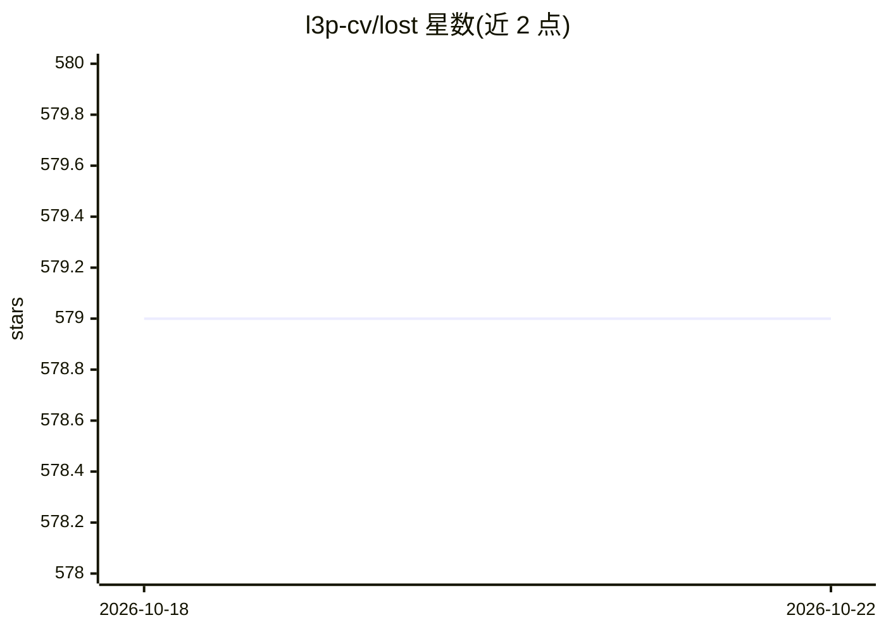

# l3p-cv/lost

⭐ 579 · Python · MIT · 推送 2026-10-21 · [GitHub](https://github.com/l3p-cv/lost) · [官网](https://lost.training) · 组织维护

**面向协作的半自动图像标注 Web 框架**

LOST 是一个基于浏览器的协作式图像标注框架，支持边界框、多边形、点、线的标注（单图工具 SIA）与整图聚类标注（多图工具 MIA）。提供开箱即用的标注管线，无需编程即可启动标注流程，也允许用户自定义管线组合不同标注界面与算法，用于构建半自动标注（如以 AI 生成的标注提案供标注者确认）。支持连接 AWS S3、Azure Blob、FTP 等外部文件系统，具备标签树管理、标注统计、复核、Jupyter-Lab 集成、LDAP 集成与可扩展的多机分布式设计。通过 Docker 容器发布，用 quick_setup 脚本部署。

## 筛选速览

| 维度 | 判定 | 备注 |
|---|---|---|
| AI 角色 | `ai-enhanced` | 去掉 AI 部分产品仍成立 |
| 许可风险 | `permissive` | MIT |
| 部署形态 | `library` | 以包/库形式分发 |
| 模型依赖 | — | README 未给出锁定关系 |
| 硬件要求 | — | 无带数字的原话,不猜 |
| 安装摩擦 | `low` | 无编译、无系统依赖或容器化 |
| 成熟度 | — | 结构信号不足 |

## 能力要点

- 开箱即用的标注管线，无需编程知识
- 支持 bbox/多边形/点/线与整图聚类的多界面标注
- AI 标注提案的半自动标注管线
- 可连接 S3/Azure Blob/FTP 外部文件系统，支持分布式扩展

## 适用场景

- 团队协作完成大规模图像标注任务
- 用 AI 提案加速半自动标注并人工复核
- 管理标注进度、标签树与标注统计数据集导出

## 场景标签

 · 领域:计算机视觉/数据标注

## 证据(README 行号)

> L28: LOST was especially designed to model **semi-automatic** annotation
> L30: Such a semi-automatic can be achieved by using AI generated annotation

## 星数曲线

2026-10-18 579 → 2026-10-22 579（+0）

---
*卡片 v1 · prompt 1.4 · 生成 2026-10-21 · 置信度 mid · 依据 README sha `0a9194ccd143` · [字段定义](../../DATASET.md)*
