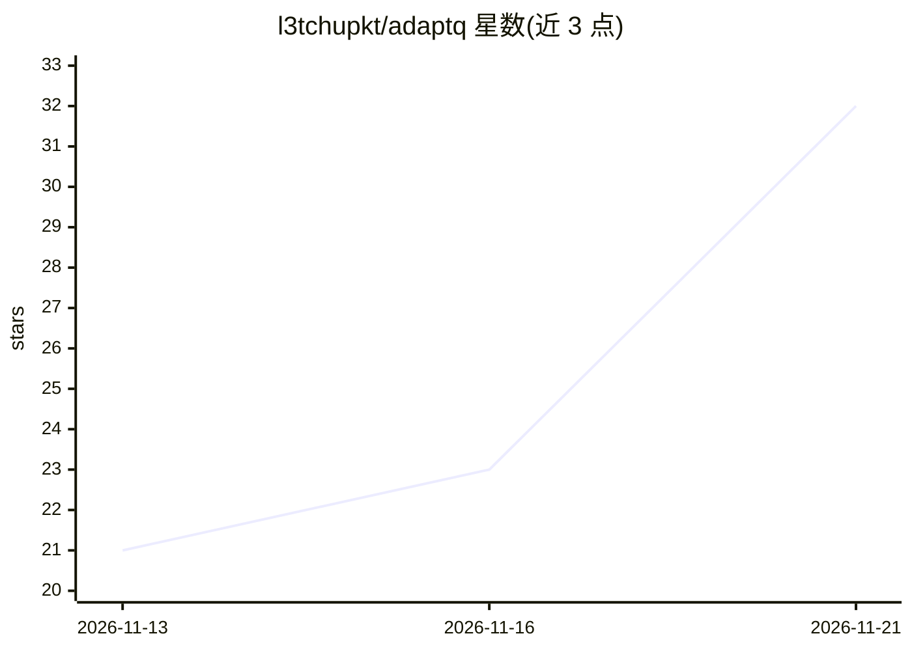

# l3tchupkt/adaptq

⭐ 32 · C++ · 推送 2026-10-06 · [GitHub](https://github.com/l3tchupkt/adaptq) · [官网](https://github.com/l3tchupkt/adaptq) · 个人维护

**面向 CPU LLM 推理的 KV 缓存量化引擎（C++17 + Python 绑定）**

AdapTQ 是用于 CPU 环境 LLM 推理的 KV-cache 量化引擎：每 token 经过 Rademacher 符号随机化、快速 Walsh-Hadamard 变换后做 2/3/4-bit Max-Lloyd 标量量化，以位打包环形缓冲存储，注意力计算经质心查找表直接完成。C++17 核心含 AVX2 SIMD 路径与标量回退，提供 pybind11 Python 绑定及 HuggingFace Transformers 与 llama-cpp-python 多后端运行时，另带 PyTorch 适配器。限制：仅 CPU、batch size 必须为 1；仅在小模型（0.5B/1.1B）上评估，未演示端到端生成加速。面向做 LLM 推理优化的开发者。

## 筛选速览

| 维度 | 判定 | 备注 |
|---|---|---|
| AI 角色 | `ai-ecosystem` | LLM/agent 周边工具 |
| 许可风险 | `none` | — |
| 部署形态 | `library` | 以包/库形式分发 |
| 模型依赖 | — | README 未给出锁定关系 |
| 硬件要求 | `cpu-ok` | |
| 安装摩擦 | `low` | 无编译、无系统依赖或容器化 |
| 成熟度 | — | 结构信号不足 |

## 能力要点

- Rademacher 随机化 + FWHT 预处理后做 2/3/4-bit 标量量化
- AVX2 SIMD 路径（x86）与标量回退，位打包环形缓冲 O(1) 追加/驱逐
- K/V 可独立设置位宽，支持每层独立 Engine 的层感知配置（AdapTQ-LA）
- 多后端运行时：HuggingFace Transformers 与 llama-cpp-python

## 适用场景

- 在 CPU 上压缩 LLM 推理的 KV 缓存内存占用
- 为 Transformers / llama-cpp-python 推理接入 KV 量化
- 复现或验证层感知非对称量化（AdapTQ-LA）研究配置

## 场景标签

`模型量化` · 领域:训练与推理

## 证据(README 行号)

> L17: **AdapTQ** is a CPU-oriented KV-cache quantization engine for Large Language Model inference. It implements Rademac
> L42: - **Multi-backend Python runtime** for HuggingFace Transformers and llama-cpp-python

## 星数曲线

2026-11-13 21 → 2026-11-21 32（+11）

---
*卡片 v1 · prompt 1.4 · 生成 2026-11-18 · 置信度 high · 依据 README sha `152200b54633` · [字段定义](../../DATASET.md)*
