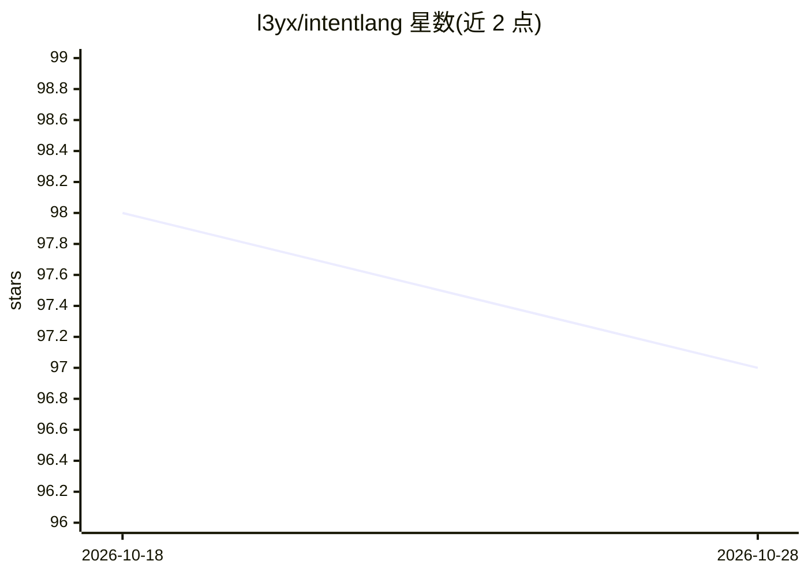

# l3yx/intentlang

⭐ 97 · Python · MIT · 推送 2026-01-11 · [GitHub](https://github.com/l3yx/intentlang) · 个人维护 · 中文 README

**面向 AI Agent 的意图驱动编程框架，基于 Python**

构建在 Python 之上的 AI 原生编程框架：开发者以 Intent 对象（goal/ctxs/tools/input/how/rules/output 七要素）声明任务，框架将其转为 XML 中间表示并引导 LLM 生成 Python 代码，在嵌入式 REPL 运行时中迭代执行直至产出符合 Pydantic 结构的结果。输入数据不序列化进 LLM 上下文，仅传递元数据；任意 Python 对象（数据库连接、浏览器实例等）可注入为工具。要求 Python 3.10+，通过环境变量配置 OPENAI 兼容 API（示例含 DeepSeek/通义/智谱）。README 明确警告 AI 生成代码在本地运行时执行，建议在 Docker/沙箱/虚拟机中隔离运行。

## 筛选速览

| 维度 | 判定 | 备注 |
|---|---|---|
| AI 角色 | `ai-ecosystem` | LLM/agent 周边工具 |
| 许可风险 | `permissive` | MIT |
| 部署形态 | `library` | 以包/库形式分发 |
| 模型依赖 | — | README 未给出锁定关系 |
| 硬件要求 | — | 无带数字的原话,不猜 |
| 安装摩擦 | `low` | 无编译、无系统依赖或容器化 |
| 成熟度 | — | 结构信号不足 |

## 能力要点

- Intent 七要素形式化声明，编译为可执行 Executor
- 输入数据不进入 LLM 上下文，AI 生成代码按需访问内存对象
- 任意 Python 对象可作为工具注入，与宿主程序共享运行时
- 支持 top-level await 的嵌入式 REPL 运行时

## 适用场景

- 用自然语言意图驱动 Python 程序中的 AI 执行单元
- 让 AI 直接操作宿主程序已初始化的对象（如 Playwright 浏览器）
- 以 Pydantic 结构化输出完成任务并迭代收敛

## 场景标签

`Agent 框架` · 领域:Agent 开发

## 证据(README 行号)

> L56: IntentLang is the first framework to **formally represent human intent** (Goal, Contexts, Tools, Input, Strategy, C
> L166: The core of IntentLang revolves around the construction of the `Intent` object, which transforms natural language 

## 星数曲线

2026-10-18 98 → 2026-10-28 97（-1）

---
*卡片 v1 · prompt 1.4 · 生成 2026-10-23 · 置信度 high · 依据 README sha `75f01aabd312` · [字段定义](../../DATASET.md)*
