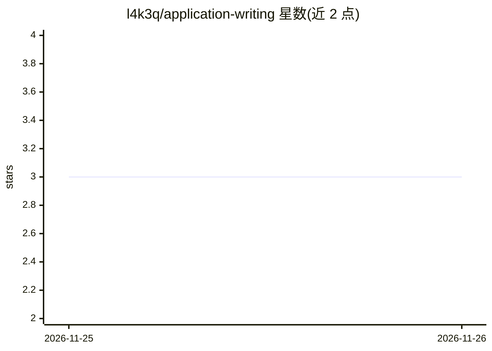

# l4k3q/application-writing

⭐ 3 · 推送 2026-10-25 · [GitHub](https://github.com/l4k3q/application-writing) · 个人维护 · 中文 README

**留学申请文书写作的 Codex skill：调研、起草与修订五类文书**

一个安装到 Codex 的申请文书写作 skill，覆盖 PS、SOP、RL、CV/简历与暑研申请信五类文书。工作流程分四阶段：核对目标项目官方要求并分析公开样例、从申请人真实材料中提出并推荐 2–3 条文书主线、按文书用途规划起草、输出目标语言版本并附逐段中文参考译文。强调以证据支撑的经历为基础，不虚构职业目标或个人感受；推荐信建议稿须由推荐人审核。仓库含 SKILL.md 流程说明、分类型写作参考与五类各 8 个结构模板。

## 筛选速览

| 维度 | 判定 | 备注 |
|---|---|---|
| AI 角色 | `ai-native` | 本体是模型或模型工具 |
| 许可风险 | `none` | — |
| 部署形态 | `None` |  |
| 模型依赖 | — | README 未给出锁定关系 |
| 硬件要求 | — | 无带数字的原话,不猜 |
| 安装摩擦 | `low` | 无编译、无系统依赖或容器化 |
| 成熟度 | — | 结构信号不足 |

## 能力要点

- 五类文书（PS/SOP/RL/CV/暑研申请信）的分阶段写作流程
- 基于申请人材料提出 2–3 条文书主线并推荐，记录到 requirements.md 与 portrait.md
- 双语交付：目标语言全文附逐段中文参考译文
- assets/ 提供五类文书各 8 个附来源链接的结构模板

## 适用场景

- 为留学申请起草和修订个人陈述、目的陈述或推荐信材料
- 暑研申请前核对项目官方要求并规划申请信主线
- 基于已有 CV 与项目经历梳理可核验的文书叙事

## 场景标签

`AI 写作` · 领域:内容生成

## 证据(README 行号)

> L7: 一个用于 Codex 的申请文书写作 skill，覆盖个人陈述（PS）、目的陈述（SOP）、推荐信材料（RL）、履历（CV / résumé）和暑研申请信。它从申请要求和申请人的真实经历出发，帮助调研、挖掘主线、规划结构、起草及修订
> L57: 在 Codex 中调用 `$application-writing`，给出目标项目和你已有的材料；不需要先想好文书主线。例如：

## 星数曲线

2026-11-25 3 → 2026-11-26 3（+0）

---
*卡片 v1 · prompt 1.4 · 生成 2026-11-24 · 置信度 high · 依据 README sha `96ba266780e4` · [字段定义](../../DATASET.md)*
