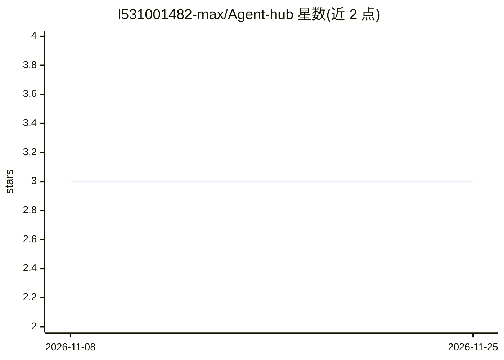

# l531001482-max/Agent-hub

⭐ 3 · JavaScript · MIT · 推送 2026-11-10 · [GitHub](https://github.com/l531001482-max/Agent-hub) · [官网](https://agentsworkspace.dev) · 个人维护 · 中文 README

**本地自托管的多智能体群聊与任务协作台**

一个本地运行的 Web 应用：把多个 AI 智能体（Claude Code、Codex、DeepSeek 等兼容接口、Ollama/LM Studio/MLX/llama.cpp 本地模型、自定义 HTTP 程序）放进同一个群聊房间。提供自由讨论、头脑风暴、分工协作三种模式；分工模式下负责人拆解子任务生成依赖感知的任务清单与流程图，成员并行执行后由负责人整合。内置每智能体 token 用量与月度预算、文件上传解析、手机扫码访问与访问码登录。Node.js 运行，无构建步骤，UI 与文档为中文。

## 筛选速览

| 维度 | 判定 | 备注 |
|---|---|---|
| AI 角色 | `ai-native` | 本体是模型或模型工具 |
| 许可风险 | `permissive` | MIT |
| 部署形态 | `library` | 以包/库形式分发 |
| 模型依赖 | local-ok | 支持本地模型 |
| 硬件要求 | — | 无带数字的原话,不猜 |
| 安装摩擦 | `medium` | 含编译或系统依赖之一 |
| 成熟度 | — | 结构信号不足 |

## 能力要点

- 三种协作模式：自由讨论、头脑风暴、分工协作（依赖感知任务清单与流程图）
- 接入 Claude Code/Codex 本机账号、OpenAI 兼容接口及多种本地模型运行时
- 每智能体 token 记账与月度预算，超限自动跳过
- 文件上传解析（图片/PDF/Office/视频截帧）与智能体间交接单机制

## 适用场景

- 让多个模型在群聊里头脑风暴并互评点子
- 把任务拆给不同擅长领域的智能体并行完成
- 在本地接入自己的微调模型参与协作讨论
- 按月预算控制各家模型 API 开销

## 场景标签

`多智能体` `聊天机器人` · 领域:Agent 开发

## 证据(README 行号)

> L3: 让多个 AI 智能体在同一个群聊里**一起讨论、头脑风暴、分工完成任务**。全部在本机运行，聊天记录和配置都存在本地。
> L7: > **English:** Agent Hub is a self-hosted web app where multiple AI agents (Claude Code, Codex, DeepSeek, any OpenAI
> L22: - **什么模型都能接**：Claude Code、Codex（用本机登录的账号）、Claude API、DeepSeek 等 OpenAI 兼容接口、本机模型（能自动查找、自动启动）、自定义 JSON 接口、推理脚本、自己写的 

## 星数曲线

2026-11-08 3 → 2026-11-25 3（+0）

---
*卡片 v1 · prompt 1.4 · 生成 2026-11-21 · 置信度 mid · 依据 README sha `a4e2a2adba8a` · [字段定义](../../DATASET.md)*
