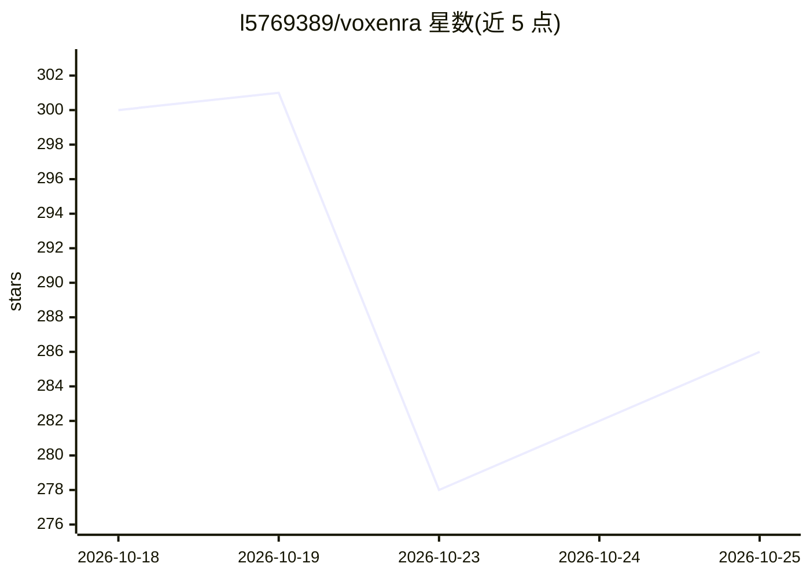

# l5769389/voxenra

⭐ 286 · Python · 推送 2026-10-20 · [GitHub](https://github.com/l5769389/voxenra) · [官网](https://l5769389.github.io/voxenra/) · 个人维护 · 中文 README

**跨平台 DICOM 阅片工作台，带本地 AI 自动分割**

面向 CT、MR 与 PET 的桌面 DICOM 工作站，覆盖本地/PACS 影像导入、二维阅片、MPR/3D/4D 重建、PET/CT 融合、测量分割与 QA 分析报告。AI 部分为接入已有 TotalSegmentator 环境的本地自动分割（需另行安装），支持 CUDA、Apple MPS 或 CPU 推理，器官结果可叠加、画笔精修并导出 SEG/NRRD。提供 macOS（含 Apple Silicon）与 Windows 安装版/便携版；暂不支持 NIfTI、动态 PET、MR 4D 与 RTSTRUCT 导入。

## 筛选速览

| 维度 | 判定 | 备注 |
|---|---|---|
| AI 角色 | `ai-enhanced` | 去掉 AI 部分产品仍成立 |
| 许可风险 | `none` | — |
| 部署形态 | `None` |  |
| 模型依赖 | — | README 未给出锁定关系 |
| 硬件要求 | — | 无带数字的原话,不猜 |
| 安装摩擦 | `medium` | 含编译或系统依赖之一 |
| 成熟度 | — | 结构信号不足 |

## 能力要点

- 三平面 MPR、斜面重建、3D 体绘制与 CT 多时相 4D
- PET/CT 融合含手动刚性配准与融合 3D
- TotalSegmentator 本地 AI 多器官分割，结果可精修与导出 SEG/NRRD
- CT 水模 QA、点源 MTF 等分析，测量分割导出 DICOM SR/SEG、CSV/PDF

## 适用场景

- 放射科式阅片：多序列对比、调窗伪彩与 MPR/3D 查看
- 对 CT 做多器官自动分割并手工精修
- PET/CT 融合阅片与配准对比
- 做 CT 设备质量保证（水模 QA、MTF、FWHM）分析

## 场景标签

`目标检测` · 领域:感知与多模态

## 证据(README 行号)

> L9: 面向 CT、MR 与 PET 的跨平台 DICOM 工作台，集阅片、三维重建、影像融合与测量分割于一体。支持 **基于 TotalSegmentator 的本地 AI 自动分割**，结果可直接查看、精修和保存。
> L22: |本地 AI 自动分割|接入 TotalSegmentator，CT 多器官快速分割；器官搜索与选择、结果叠加、画笔精修、撤销和工作区保存。|
> L31: - **本机推理**：连接已有 TotalSegmentator 环境，计算当前时相的完整 CT；支持按环境选择 CUDA、Apple MPS 或 CPU。

## 星数曲线

2026-10-18 300 → 2026-10-25 286（-14）

---
*卡片 v1 · prompt 1.4 · 生成 2026-10-21 · 置信度 high · 依据 README sha `32092328dec9` · [字段定义](../../DATASET.md)*
