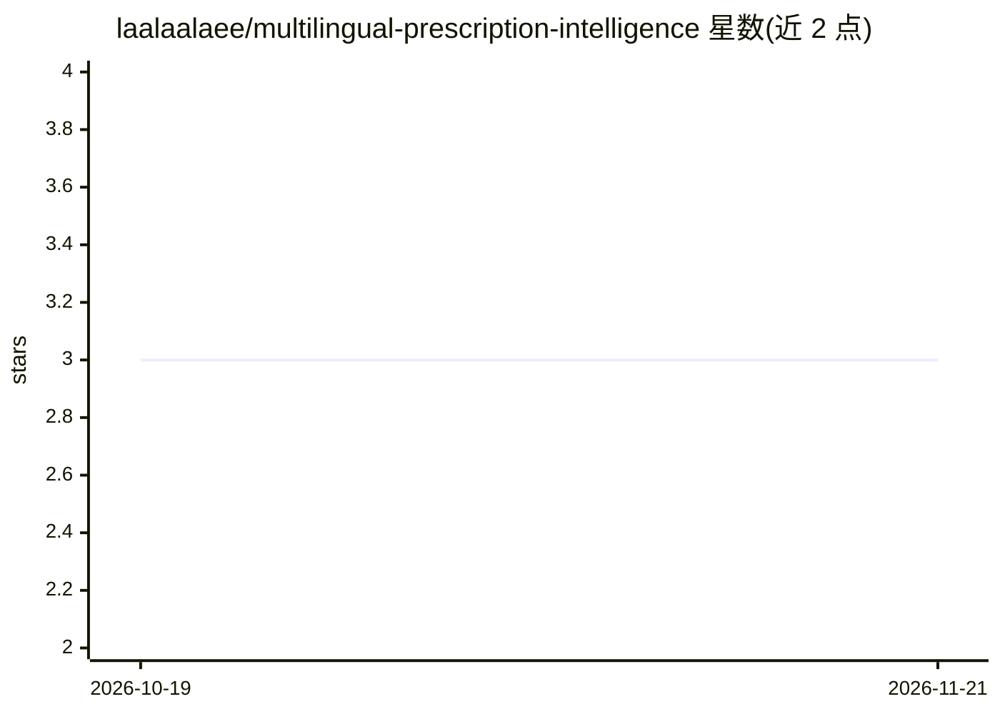

# laalaalaee/multilingual-prescription-intelligence

⭐ 3 · Python · MIT · 推送 2026-10-18 · [GitHub](https://github.com/laalaalaee/multilingual-prescription-intelligence) · 个人维护

**识别手写处方、提示药物相互作用并翻译的 AI 原型**

学生课程项目原型：上传手写处方照片后，FastAPI 后端经图像清理与分行，用 TrOCR 逐行识别文字，药品名经 RapidFuzz 模糊匹配，再在 MySQL/MariaDB 表中查询药物相互作用（规则表含五对），可用 MarianMT 将结果翻译为印地语或法语；同进程提供 /dashboard 页面，每次请求记录日志。README 明确声明非医疗工具，交互规则仅五对，无用户账号与 HTTPS，不面向公网部署。

## 筛选速览

| 维度 | 判定 | 备注 |
|---|---|---|
| AI 角色 | `ai-native` | 本体是模型或模型工具 |
| 许可风险 | `permissive` | MIT |
| 部署形态 | `library` | 以包/库形式分发 |
| 模型依赖 | — | README 未给出锁定关系 |
| 硬件要求 | — | 无带数字的原话,不猜 |
| 安装摩擦 | `medium` | 含编译或系统依赖之一 |
| 成熟度 | `idea` | |

## 能力要点

- TrOCR 手写识别 + RapidFuzz 药品名模糊匹配
- MySQL/MariaDB 相互作用规则表查询（当前五对）
- MarianMT 翻译为印地语或法语
- 单命令启动，FastAPI 同进程托管仪表盘

## 适用场景

- 体验手写处方 OCR 到翻译的完整流程
- 作为课程/原型项目的参考实现
- 本地测试图像质量对识别与匹配的影响

## 场景标签

`OCR` · 领域:感知与多模态

## 证据(README 行号)

> L3: Upload a photo of a handwritten prescription. The app reads it, picks out the medicines, warns about known drug inte
> L12: 2. A background worker cleans the image, splits the page into lines, and reads each line with TrOCR.
> L22: You need Python 3.11+, a MySQL or MariaDB server, and preferably an NVIDIA GPU.

## 星数曲线

2026-10-19 3 → 2026-11-21 3（+0）

---
*卡片 v1 · prompt 1.4 · 生成 2026-11-21 · 置信度 mid · 依据 README sha `fad355bf7a4b` · [字段定义](../../DATASET.md)*
