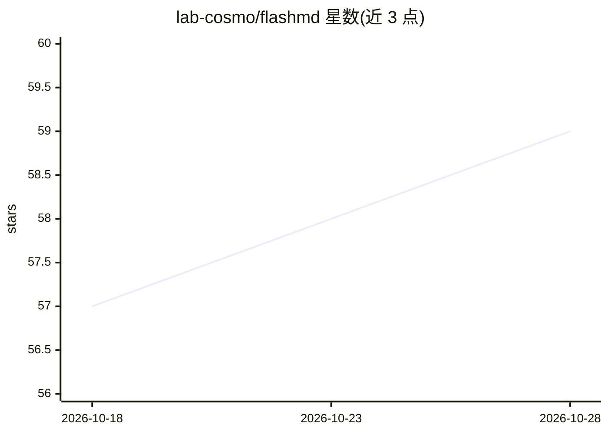

# lab-cosmo/flashmd

⭐ 61 · Python · Apache-2.0 · 推送 2026-09-23 · [GitHub](https://github.com/lab-cosmo/flashmd) · [官网](https://papers.nips.cc/paper_files/paper/2025/file/7ffade093764c9a59a777c3cbe346b97-Paper-Conference.pdf) · 组织维护

**用长步长机器学习模型预测分子动力学轨迹的工具库**

提供自定义积分器与预训练模型，以远大于常规 MD 的时间步长学习并预测分子动力学轨迹；预训练模型在 r2SCAN 理论水平复现 ab-initio MD。通过 pip 安装，支持 ASE、LAMMPS 与 i-PI 三种接口（i-PI 为最成熟接口，论文结果均由其生成），并可经 metatrain 库从头训练或微调自有模型。README 声明为实验性软件，存在能量均分损失问题，建议用 Langevin 温控并以传统 MD 复核结果。

## 筛选速览

| 维度 | 判定 | 备注 |
|---|---|---|
| AI 角色 | `ai-native` | 本体是模型或模型工具 |
| 许可风险 | `permissive` | Apache-2.0 |
| 部署形态 | `library` | 以包/库形式分发 |
| 模型依赖 | — | README 未给出锁定关系 |
| 硬件要求 | — | 无带数字的原话,不猜 |
| 安装摩擦 | `low` | 无编译、无系统依赖或容器化 |
| 成熟度 | `idea` | |

## 能力要点

- 长步长轨迹预测，建议步长为常规 MD 的 10-30 倍
- 支持 ASE、LAMMPS、i-PI 三种运行接口
- 预训练模型首次调用时自动下载，附带对应势能模型
- 可经 metatrain 库从头训练或微调模型

## 适用场景

- 用大时间步长加速材料体系的分子动力学模拟
- 在 LAMMPS/i-PI 中运行 NPT 系综或元动力学模拟
- 基于通用预训练模型微调自己的 FlashMD 模型

## 场景标签

 · 领域:计算材料科学/分子模拟

## 证据(README 行号)

> L3: This repository contains custom integrators to run MD trajectories with FlashMD models. These models are
> L4: designed to learn and predict molecular dynamics trajectories using long strides, therefore allowing
> L8: The pre-trained models we make available are trained to reproduce ab-initio MD at the r2SCAN level of theory.

## 星数曲线

2026-10-18 57 → 2026-10-28 59（+2）

---
*卡片 v1 · prompt 1.4 · 生成 2026-10-24 · 置信度 high · 依据 README sha `760d35fccb3c` · [字段定义](../../DATASET.md)*
