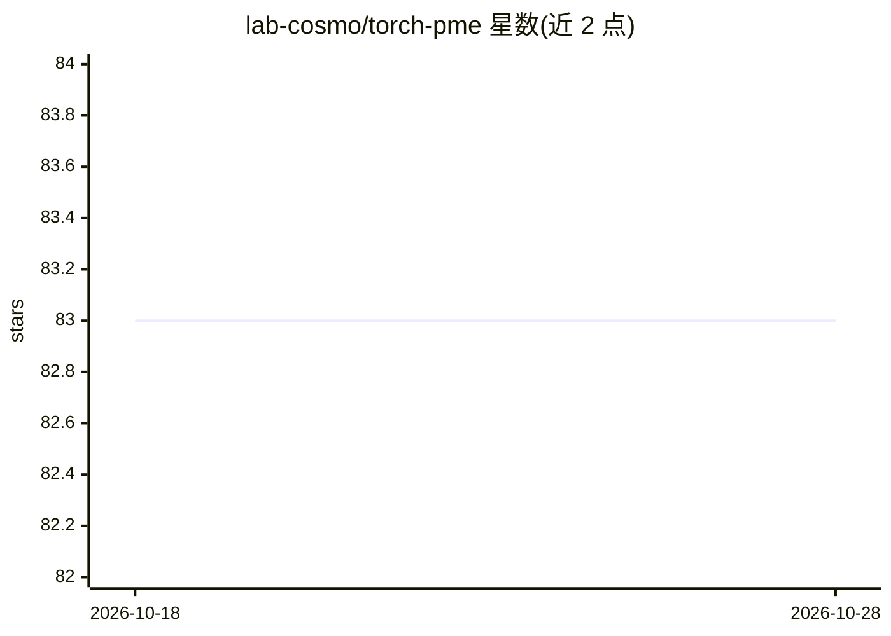

# lab-cosmo/torch-pme

⭐ 83 · Python · BSD-3-Clause · 推送 2026-08-03 · [GitHub](https://github.com/lab-cosmo/torch-pme) · [官网](https://lab-cosmo.github.io/torch-pme/) · 组织维护

**PyTorch 长程相互作用计算库：可微的粒子网格 Ewald 方法**

面向原子尺度模拟与机器学习研究的 Python 库，提供 P3M、PME、标准 Ewald 及非周期方法计算单极 1/r 及任意阶 1/r^p 势，偶极部分支持 1/r^3 的 Ewald 方法。支持对粒子位置、电荷/偶极与胞参数的自动微分，可用于力的自动计算与机器学习任务中的可微长程项。兼容 CPU 与 GPU，可 TorchScript 导出脱离 Python 运行（如 C++ 环境）；另有实验性 JAX 实现与可选的 metatensor 绑定。以 pip/conda 安装，附 JCP 论文可引用。

## 筛选速览

| 维度 | 判定 | 备注 |
|---|---|---|
| AI 角色 | `ai-ecosystem` | LLM/agent 周边工具 |
| 许可风险 | `permissive` | BSD-3-Clause |
| 部署形态 | `library` | 以包/库形式分发 |
| 模型依赖 | — | README 未给出锁定关系 |
| 硬件要求 | — | 无带数字的原话,不猜 |
| 安装摩擦 | `low` | 无编译、无系统依赖或容器化 |
| 成熟度 | `idea` | |

## 能力要点

- P3M/PME/Ewald/非周期方法计算长程相互作用
- 对位置、电荷/偶极、胞参数的自动微分
- 支持任意阶 1/r^p 势与偶极 1/r^3 势
- CPU/GPU 运行，支持 TorchScript 导出

## 适用场景

- 分子动力学模拟中计算静电等长程相互作用
- 原子机器学习模型中嵌入可微长程项
- 将长程计算导出为脱离 Python 的高性能生产环境代码

## 场景标签

`科研工具` · 领域:学习与行业

## 证据(README 行号)

> L11: ``torch-pme`` enables efficient and auto-differentiable computation of long-range
> L14: *charges*/*dipoles*, and *cell* parameters, allowing not only the automatic computation
> L15: of forces but also enabling general applications in machine learning tasks. For

## 星数曲线

2026-10-18 83 → 2026-10-28 83（+0）

---
*卡片 v1 · prompt 1.4 · 生成 2026-10-24 · 置信度 high · 依据 README sha `0ce4e205d9c1` · [字段定义](../../DATASET.md)*
