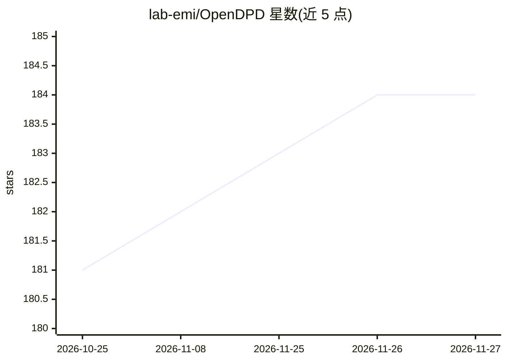

# lab-emi/OpenDPD

⭐ 184 · Python · Apache-2.0 · 推送 2026-11-23 · [GitHub](https://github.com/lab-emi/OpenDPD) · [官网](https://www.tudemi.com) · 组织维护

**面向射频工程师的功放建模与数字预失真训练框架**

由 TU Delft EMI 实验室开发的 PyTorch 框架，覆盖功率放大器（PA）行为建模与数字预失真（DPD）训练全流程：生成或导入 I/Q 数据、训练 PA 行为模型、级联训练预失真器、导出预失真 I/Q 信号供实测。提供三种入口——浏览器版/本地版 OpenDPD Studio（pywebview 图形界面）、无头 CLI、Python API，共享同一训练核心；另设 DPD Arena 基准，以冻结 PA 模型对 250–2,000 参数量级的 DPD 配置按 EVM、ACLR 与复杂度 FoM 排名。文档强调经 PA 模型评估的 DPD 结果属于仿真，需实测验证线性化性能。

## 筛选速览

| 维度 | 判定 | 备注 |
|---|---|---|
| AI 角色 | `ai-native` | 本体是模型或模型工具 |
| 许可风险 | `permissive` | Apache-2.0 |
| 部署形态 | `library` | 以包/库形式分发 |
| 模型依赖 | — | README 未给出锁定关系 |
| 硬件要求 | — | 无带数字的原话,不猜 |
| 安装摩擦 | `medium` | 含编译或系统依赖之一 |
| 成熟度 | — | 结构信号不足 |

## 能力要点

- PA 建模→DPD 训练→测试导出的四步工作流，支持实测 I/Q 数据导入
- 浏览器 Studio、CLI 与 Python API 三种入口共用同一训练核心
- DPD Arena 基准：冻结 TRes-GRU PA 模型上的参数量-性能 Pareto 对比
- uv 自动按平台/驱动选择 PyTorch 后端，优先 CUDA 或 Apple MPS

## 适用场景

- 用实测功放数据训练行为模型并仿真线性化效果
- 为功放生成可导出用于实测的预失真 I/Q 信号
- 在 DPD Arena 上对比自己的 DPD 网络配置并复现论文结果

## 场景标签

`模型训练` · 领域:训练与推理

## 证据(README 行号)

> L19: OpenDPD is a PyTorch framework for power amplifier (PA) modeling and digital predistortion (DPD), developed by the 
> L61: Studio 2.3 adds **DPD Arena** with Rank, Submit and Rules pages. The benchmark uses only **APA_200MHz_b**. Compare 
> L76: |1. Make or select data|Generate x → configure a Virtual PA → simulate y → create a paired dataset; or open existin

## 星数曲线

2026-10-25 181 → 2026-11-27 184（+3）

---
*卡片 v1 · prompt 1.4 · 生成 2026-11-26 · 置信度 high · 依据 README sha `74e294d8fc7b` · [字段定义](../../DATASET.md)*
