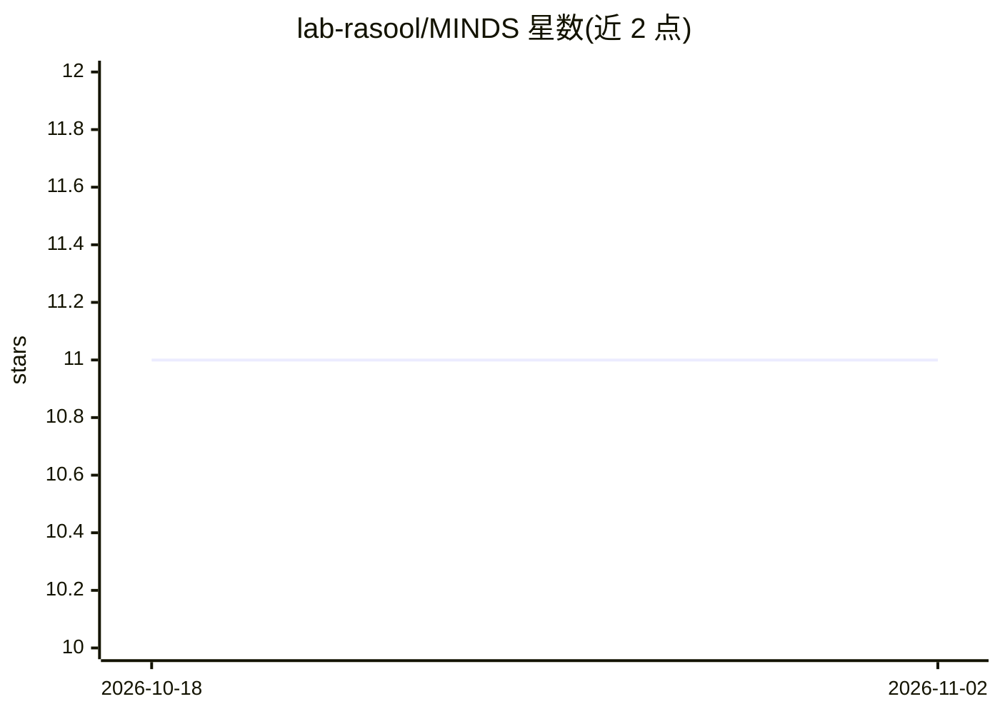

# lab-rasool/MINDS

⭐ 11 · Python · NOASSERTION · 推送 2026-02-23 · [GitHub](https://github.com/lab-rasool/MINDS) · [官网](https://lab-rasool.github.io/MINDS/) · 组织维护

**面向肿瘤研究者的多模态肿瘤数据整合与队列构建框架**

MINDS 是整合多模态肿瘤数据的框架：从 NIH NCI CRDC 与 IDC 门户查询并整合临床、基因组与影像数据，覆盖 100 余个项目共 115,974 名患者。本地部署需 PostgreSQL 数据库（提供 docker 启动命令）并以 pip 安装 med-minds 包，通过 Python 接口查询数据库返回 pandas dataframe，并可按查询构建队列下载数据。v0.0.6 起数据库后端由 MySQL 迁移至 PostgreSQL 12+；影像数据源已从 TCIA 迁移至 IDC v2 API。附有论文引用。

## 筛选速览

| 维度 | 判定 | 备注 |
|---|---|---|
| AI 角色 | `ai-ecosystem` | LLM/agent 周边工具 |
| 许可风险 | `none` | NOASSERTION |
| 部署形态 | `self-host` | docker 或自建部署 |
| 模型依赖 | — | README 未给出锁定关系 |
| 硬件要求 | — | 无带数字的原话,不猜 |
| 安装摩擦 | `low` | 无编译、无系统依赖或容器化 |
| 成熟度 | — | 结构信号不足 |

## 能力要点

- 整合 115,974 名患者、100+ 项目（TCGA/CPTAC 等）的临床、基因组、影像数据
- Python 接口查询数据库并返回 pandas dataframe
- 基于查询构建研究队列并下载数据
- 本地部署使用 PostgreSQL（docker 容器方式）

## 适用场景

- 肿瘤研究需要跨模态整合临床、基因组与影像数据
- 按查询条件构建研究队列并批量下载数据
- 在本地重建并持续更新 MINDS 数据库

## 场景标签

`科研工具` · 领域:学习与行业

## 证据(README 行号)

> L16: MINDS is a framework designed to integrate multimodal oncology data. It queries and integrates data from multiple s
> L270: The MINDS python package provides a python interface to the MINDS database. You can use this interface to query th
> L293:     TITLE = {Building Flexible, Scalable, and Machine Learning-Ready Multimodal Oncology Datasets},

## 星数曲线

2026-10-18 11 → 2026-11-02 11（+0）

---
*卡片 v1 · prompt 1.4 · 生成 2026-11-02 · 置信度 high · 依据 README sha `3f85252401ff` · [字段定义](../../DATASET.md)*
