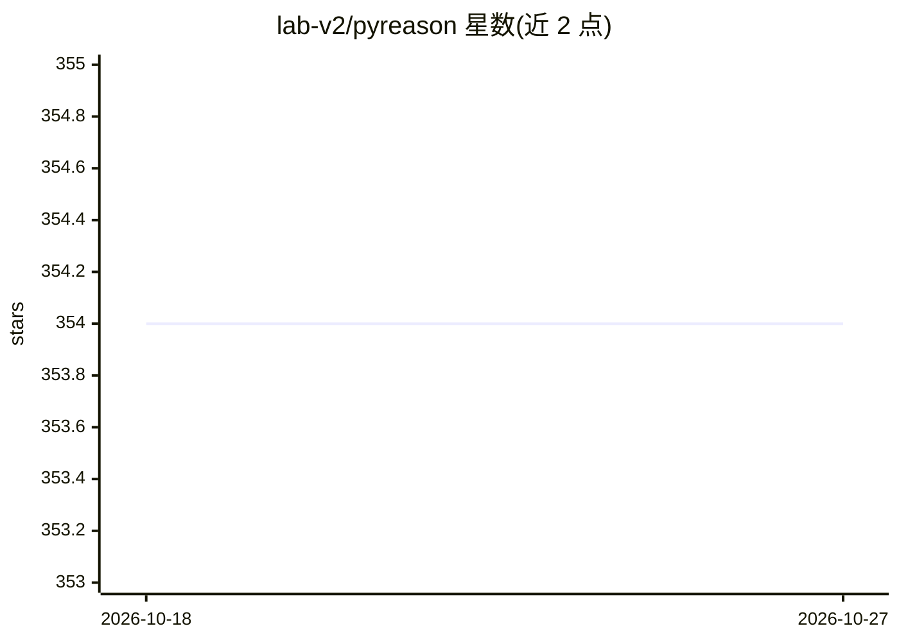

# lab-v2/pyreason

⭐ 354 · Python · NOASSERTION · 推送 2026-10-26 · [GitHub](https://github.com/lab-v2/pyreason) · [官网](https://pyreason.syracuse.edu/) · 组织维护

**开放世界时序逻辑推理软件：在图上做可解释逻辑推断**

PyReason 是一个可解释的图上推理工具：用户提供逻辑规则与初始事实，软件在图结构上进行推理，支持注释逻辑、实值、图结构与时序逻辑，面向需要开放世界推理的研究与开发场景。以 Python 库形式经 pip 安装，支持 Python 3.7-3.10，其中多核并行仅在 3.9/3.10 可用（受 numba 支持限制）。由亚利桑那州立大学相关团队维护，BSD-2-Clause 许可，附有 AAAI Spring Symposium 2023 论文、视频与 ReadTheDocs 文档。

## 筛选速览

| 维度 | 判定 | 备注 |
|---|---|---|
| AI 角色 | `ai-native` | 本体是模型或模型工具 |
| 许可风险 | `none` | NOASSERTION |
| 部署形态 | `library` | 以包/库形式分发 |
| 模型依赖 | — | README 未给出锁定关系 |
| 硬件要求 | — | 无带数字的原话,不猜 |
| 安装摩擦 | `low` | 无编译、无系统依赖或容器化 |
| 成熟度 | — | 结构信号不足 |

## 能力要点

- 基于逻辑规则与事实在图结构上推理
- 支持注释、实值、图与时序逻辑（开放世界）
- pip 安装的 Python 库，3.9/3.10 支持多核并行

## 适用场景

- 在知识图谱上执行可解释的时序逻辑推理
- 科研工作中作为神经符号推理组件引用（附论文可引）
- 构建需要规则驱动推断的应用

## 场景标签

`知识图谱` · 领域:知识与检索

## 证据(README 行号)

> L7: An explainable inference software supporting annotated, real valued, graph based and temporal logic.
> L23: PyReason is a graphical inference tool that uses a set of logical rules and facts (initial conditions) to reason ov

## 星数曲线

2026-10-18 354 → 2026-10-27 354（+0）

---
*卡片 v1 · prompt 1.4 · 生成 2026-10-21 · 置信度 high · 依据 README sha `243771d8951a` · [字段定义](../../DATASET.md)*
