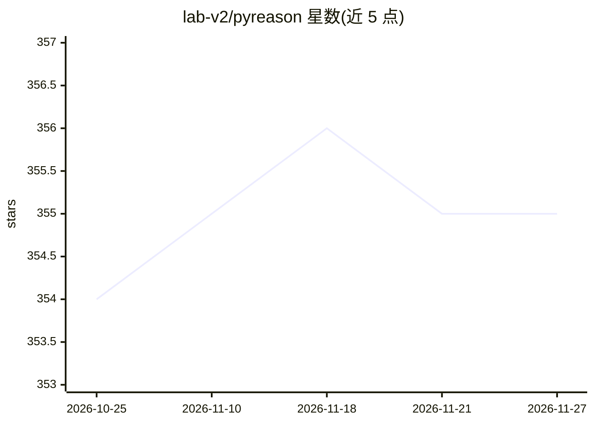

# lab-v2/pyreason

⭐ 355 · Python · NOASSERTION · 推送 2026-10-26 · [GitHub](https://github.com/lab-v2/pyreason) · [官网](https://pyreason.syracuse.edu/) · 组织维护

**面向研究者的可解释图逻辑推理库**

PyReason 是一个可解释的推理软件包：用户定义逻辑规则与事实（初始条件），在图结构上进行推理，支持标注逻辑、实数值、图结构与时序逻辑。以 Python 库形式发布（pip 安装，支持 Python 3.8–3.13），提供论文、视频、网站、PyReason Gym 与 ReadTheDocs 文档及代码示例。关联论文发表于 AAAI Spring Symposium 2023，采用 BSD-2-Clause 许可，商标归属亚利桑那州立大学。

## 筛选速览

| 维度 | 判定 | 备注 |
|---|---|---|
| AI 角色 | `ai-native` | 本体是模型或模型工具 |
| 许可风险 | `none` | NOASSERTION |
| 部署形态 | `library` | 以包/库形式分发 |
| 模型依赖 | — | README 未给出锁定关系 |
| 硬件要求 | — | 无带数字的原话,不猜 |
| 安装摩擦 | `low` | 无编译、无系统依赖或容器化 |
| 成熟度 | — | 结构信号不足 |

## 能力要点

- 基于逻辑规则与事实在图结构上推理，输出可解释
- 支持标注逻辑、实数值与时序逻辑
- 配套论文、视频、文档与 PyReason Gym
- pip 安装，支持 Python 3.8–3.13

## 适用场景

- 在图数据上做基于规则的时序逻辑推理
- 需要可解释推理过程的符号推理实验
- 神经符号研究方向结合机器学习使用逻辑推理工具

## 场景标签

`知识图谱` · 领域:知识与检索

## 证据(README 行号)

> L11: An explainable inference software supporting annotated, real valued, graph based and temporal logic.
> L27: PyReason is a graphical inference tool that uses a set of logical rules and facts (initial conditions) to reason ov

## 星数曲线

2026-10-25 354 → 2026-11-27 355（+1）

---
*卡片 v1 · prompt 1.4 · 生成 2026-11-25 · 置信度 high · 依据 README sha `fe632a5d7046` · [字段定义](../../DATASET.md)*
