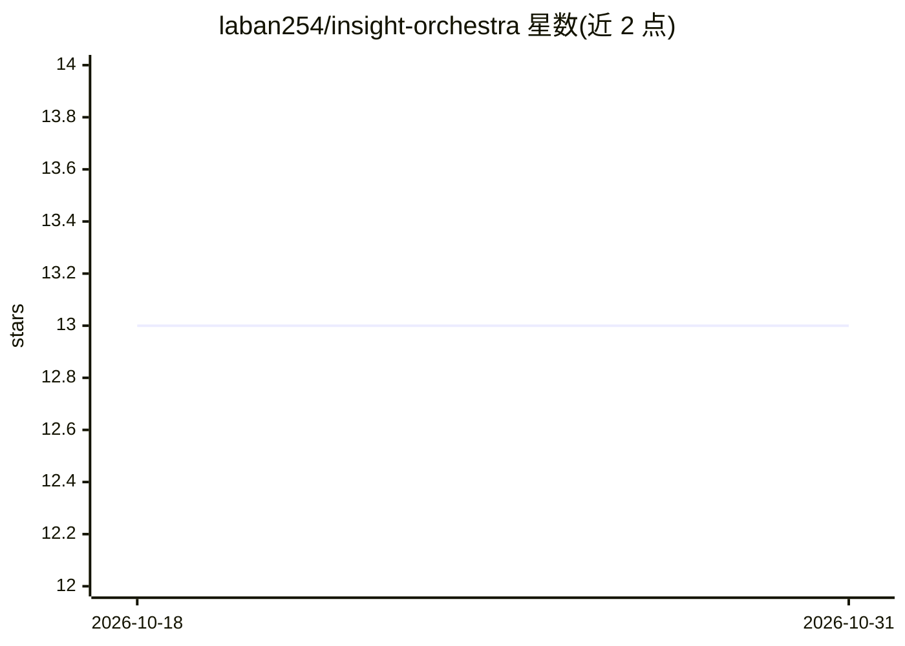

# laban254/insight-orchestra

⭐ 13 · Python · Apache-2.0 · 推送 2026-10-29 · [GitHub](https://github.com/laban254/insight-orchestra) · [官网](https://insight-orchestra.vercel.app/) · 个人维护

**可自托管的多智能体 AI 数据分析师，自然语言查询本地数据**

开源、可自托管的数据分析应用：上传 CSV/Excel/JSON/Parquet 文件或连接 PostgreSQL/MySQL/SQLite/DuckDB（只读），五阶段多智能体流水线完成数据清洗、假设生成、LLM 评分辩论与 Plotly 可视化；NLQ 智能体在 RestrictedPython 沙箱中生成并执行 pandas 代码，或对数据库生成只读 SQL。支持 OpenAI/Anthropic/DeepSeek/Ollama 四种 LLM 提供商（默认 Ollama 本地运行，无需 API key），通过 Docker Compose 一键部署，提供认证、分享链接与多格式导出。Apache 2.0 许可。

## 筛选速览

| 维度 | 判定 | 备注 |
|---|---|---|
| AI 角色 | `ai-native` | 本体是模型或模型工具 |
| 许可风险 | `permissive` | Apache-2.0 |
| 部署形态 | `self-host` | docker 或自建部署 |
| 模型依赖 | local-ok | 支持本地模型 |
| 硬件要求 | — | 无带数字的原话,不猜 |
| 安装摩擦 | `low` | 无编译、无系统依赖或容器化 |
| 成熟度 | — | 结构信号不足 |

## 能力要点

- 五阶段多智能体流水线：清洗→假设→辩论评分→可视化→总结
- NLQ 智能体在沙箱执行 pandas 代码，或生成只读 SQL 直查数据库
- 四种 LLM 提供商（OpenAI/Anthropic/DeepSeek/Ollama），运行时可切换
- 工作区历史、只读分享链接（72h）与 HTML/PDF/Markdown 导出

## 适用场景

- 把 CSV 或数据库丢给 AI 自动产出洞察与图表，再追问分析
- 数据不出本机的前提下用本地 LLM 做隐私敏感的数据分析
- 团队自托管一个带认证与审计日志的数据问答平台

## 场景标签

`数据分析` `多智能体` · 领域:Agent 开发

## 证据(README 行号)

> L7:  A self-hosted AI data analyst. Point it at a file or a database and a pipeline of specialist
> L35: Insight Orchestra is an **open-source AI data analyst you can self-host** — think Julius AI or ChatGPT's data analy
> L107: - **Natural Language Queries** — the NLQ agent generates pandas code, executes it in the RestrictedPython sandbox,

## 星数曲线

2026-10-18 13 → 2026-10-31 13（+0）

---
*卡片 v1 · prompt 1.4 · 生成 2026-10-31 · 置信度 high · 依据 README sha `18a4b017f3ff` · [字段定义](../../DATASET.md)*
