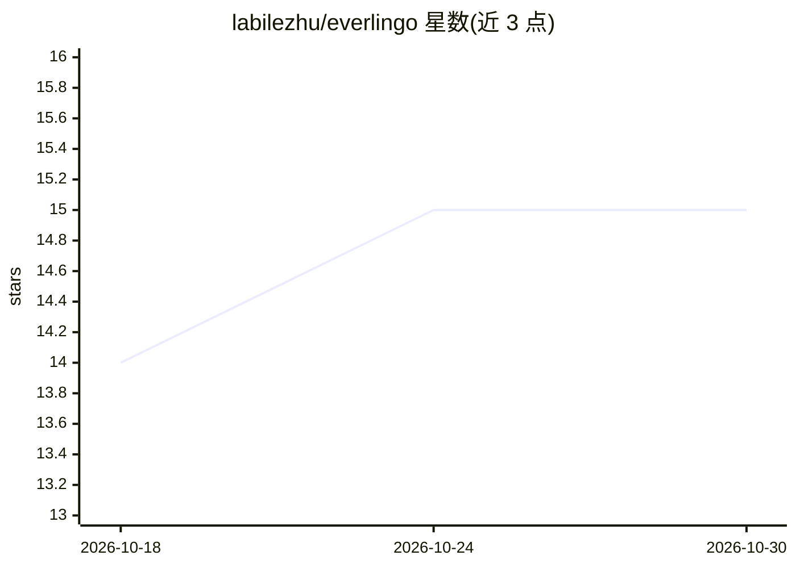

# labilezhu/everlingo

⭐ 15 · Python · MIT · 推送 2026-08-25 · [GitHub](https://github.com/labilezhu/everlingo) · 个人维护 · 中文 README

**带记忆的 AI 语言学习伴侣：查词即记笔记，按需召回**

面向外语学习者与需记忆领域术语的职场用户的 AI 语言伴侣。对话机器人 Nori 在查词、翻译、提问时将学习上下文转成笔记，构建个人知识库，后续相关话题出现时召回原上下文。偏好存于可编辑的 USER.md 并动态注入系统提示；笔记兼容 OKF 标准与 Obsidian，提供标准 MCP 接口及 Git 仓库同步。访问渠道含 PWA、浏览器扩展、终端 TUI、微信（需自托管），支持英/中/日/法/德五种目标语言。基于 Python + LangChain + FastAPI，Gateway 多会话架构，Docker 部署，需自备 OpenAI 兼容 API key。作者自述处于早期阶段。

## 筛选速览

| 维度 | 判定 | 备注 |
|---|---|---|
| AI 角色 | `ai-native` | 本体是模型或模型工具 |
| 许可风险 | `permissive` | MIT |
| 部署形态 | `library` | 以包/库形式分发 |
| 模型依赖 | — | README 未给出锁定关系 |
| 硬件要求 | — | 无带数字的原话,不猜 |
| 安装摩擦 | `low` | 无编译、无系统依赖或容器化 |
| 成熟度 | `idea` | |

## 能力要点

- 查词/翻译/提问时自动生成保留学习上下文的笔记，相关话题再出现时召回
- 偏好以 USER.md（自由 Markdown）存储并动态注入 Agent 系统提示
- 笔记兼容 OKF 标准与 Obsidian，提供标准 MCP 接口与 Git 同步
- 多渠道访问：PWA、浏览器扩展、终端 TUI、微信 ClawBot（自托管、免公网 IP）

## 适用场景

- 阅读外文网页时即点即查，自动留下带上下文的笔记
- 反复查同一个词的学习者建立可召回的个人词汇知识库
- 职场用户积累并复习领域专属术语
- 在微信里随手问答并语音输入来学习外语

## 场景标签

`聊天机器人` `知识库管理` · 领域:对话与助手

## 证据(README 行号)

> L34: In one sentence: **An AI language companion with memory.**
> L36: EverLingo is an AI language companion that **captures your learning context as you learn**. When you look up a word

## 星数曲线

2026-10-18 14 → 2026-10-30 15（+1）

---
*卡片 v1 · prompt 1.4 · 生成 2026-10-30 · 置信度 mid · 依据 README sha `a2f2546e2f32` · [字段定义](../../DATASET.md)*
