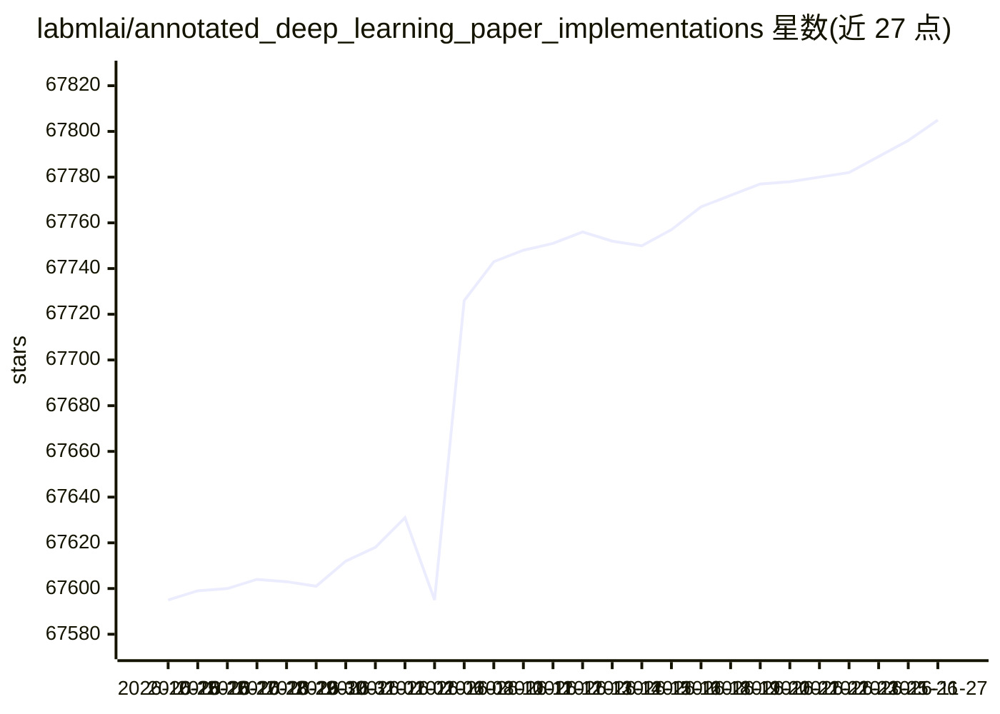

# labmlai/annotated_deep_learning_paper_implementations

⭐ 67,805 · Python · MIT · 推送 2026-11-02 · [GitHub](https://github.com/labmlai/annotated_deep_learning_paper_implementations) · [官网](https://nn.labml.ai) · 组织维护

**为深度学习学习者提供 60+ 论文的 PyTorch 注释实现**

以 PyTorch 实现神经网络及相关算法的论文合集，覆盖 Transformer 变体、LoRA、扩散模型、GAN、强化学习、优化器、归一化层、蒸馏等主题。每份实现附带解释性文档，通过官网渲染为代码与注释并排的笔记形式，帮助理解算法。仓库持续维护更新，通过 pip 安装 labml-nn 库即可使用，另提供可与编码 agent 配合的注释实现 Skill。

## 筛选速览

| 维度 | 判定 | 备注 |
|---|---|---|
| AI 角色 | `ai-knowledge` | 知识聚合/清单类 |
| 许可风险 | `permissive` | MIT |
| 部署形态 | `library` | 以包/库形式分发 |
| 模型依赖 | — | README 未给出锁定关系 |
| 硬件要求 | — | 无带数字的原话,不猜 |
| 安装摩擦 | `low` | 无编译、无系统依赖或容器化 |
| 成熟度 | — | 结构信号不足 |

## 动量与使用信号

- 维护:`declining` — 距上次 push 269.1 天,年发版 0,39 位贡献者
- 涨星:近 1 天 **+1**(自 20261016 起算)
- 安装:pypi 包 `labml-nn` 月下载 281

## 能力要点

- 60+ 篇深度学习论文的 PyTorch 实现
- 代码与解释并排的格式化笔记形式
- 覆盖 Transformer、扩散模型、GAN、RL、优化器等多个方向
- 提供配合编码 agent 的注释实现 Skill

## 适用场景

- 学习 Transformer、GAN 等论文算法的具体实现
- 查阅优化器与归一化层的 PyTorch 代码
- 借助注释实现理解深度学习论文细节

## 场景标签

`教程课程` · 领域:学习与行业

## 证据(README 行号)

> L8: This is a collection of simple PyTorch implementations of
> L13: renders these as side-by-side formatted notes.

## 星数曲线

2026-10-25 67,595 → 2026-11-27 67,805（+210）

---
*卡片 v1 · prompt 1.4 · 生成 2026-11-22 · 置信度 high · 依据 README sha `a18e9a8a6652` · [字段定义](../../DATASET.md)*
