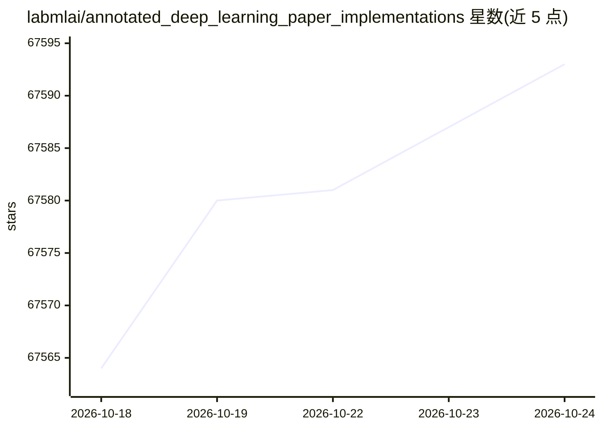

# labmlai/annotated_deep_learning_paper_implementations

⭐ 67,593 · Python · MIT · 推送 2026-01-22 · [GitHub](https://github.com/labmlai/annotated_deep_learning_paper_implementations) · [官网](https://nn.labml.ai) · 组织维护

**深度学习论文的 PyTorch 实现与旁注教程合集（60+）**

以 PyTorch 实现神经网络及相关算法的论文复现合集，配套讲解文档，官网以旁注格式并排呈现代码与笔记。覆盖 Transformer 各变体、LoRA、扩散模型（DDPM/DDIM/Stable Diffusion）、GAN 系列、强化学习（PPO/DQN）、图神经网络、优化器、归一化层、蒸馏与采样技术等。仓库持续维护、几乎每周新增实现；通过 pip 安装 labml-nn 包使用。面向学习与理解算法的读者。

## 筛选速览

| 维度 | 判定 | 备注 |
|---|---|---|
| AI 角色 | `ai-knowledge` | 知识聚合/清单类 |
| 许可风险 | `permissive` | MIT |
| 部署形态 | `library` | 以包/库形式分发 |
| 模型依赖 | — | README 未给出锁定关系 |
| 硬件要求 | — | 无带数字的原话,不猜 |
| 安装摩擦 | `low` | 无编译、无系统依赖或容器化 |
| 成熟度 | — | 结构信号不足 |

## 动量与使用信号

- 维护:`declining` — 距上次 push 269.1 天,年发版 0,39 位贡献者
- 涨星:近 1 天 **+1**(自 20261016 起算)
- 安装:pypi 包 `labml-nn` 月下载 281

## 能力要点

- 60+ 篇深度学习论文的 PyTorch 实现并配讲解笔记
- 覆盖 Transformer 变体、LoRA、扩散模型、GAN、RL、GNN、优化器等类别
- 官网以旁注格式并排渲染代码与说明
- pip 安装 labml-nn 即可使用

## 适用场景

- 对照旁注笔记理解 Transformer/扩散模型等论文算法
- 复用优化器、归一化层等组件的实现代码
- 系统学习强化学习与 GAN 的实现细节

## 场景标签

`教程课程` · 领域:学习与行业

## 证据(README 行号)

> L5: This is a collection of simple PyTorch implementations of
> L10: renders these as side-by-side formatted notes.
> L146: ### Installation

## 星数曲线

2026-10-18 67,564 → 2026-10-24 67,593（+29）

---
*卡片 v1 · prompt 1.4 · 生成 2026-10-18 · 置信度 high · 依据 README sha `b04e3a86ec21` · [字段定义](../../DATASET.md)*
