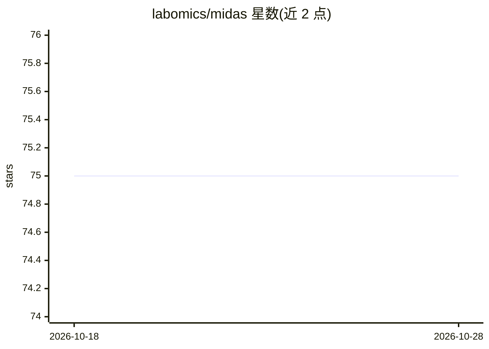

# labomics/midas

⭐ 75 · Python · MIT · 推送 2026-05-10 · [GitHub](https://github.com/labomics/midas) · 组织维护

**单细胞镶嵌多模态数据整合与填补的 PyTorch 模型**

MIDAS 算法的 PyTorch 实现，面向处理镶嵌式单细胞多模态数据（不同批次测量的模态组合不同）的生物信息学研究者：输出填补缺失模态的矩阵、批次校正结果与解耦的潜在表示，支持 RNA/ADT/ATAC 并可配置其他模态。基于 PyTorch Lightning 构建，支持多 GPU DDP 训练与参考模型微调迁移，集成 TensorBoard 训练监控。以 PyPI 包 scmidas 安装，内置 1600 细胞玩具数据集可在单 GPU 上约一分钟跑通。

## 筛选速览

| 维度 | 判定 | 备注 |
|---|---|---|
| AI 角色 | `ai-native` | 本体是模型或模型工具 |
| 许可风险 | `permissive` | MIT |
| 部署形态 | `library` | 以包/库形式分发 |
| 模型依赖 | — | README 未给出锁定关系 |
| 硬件要求 | — | 无带数字的原话,不猜 |
| 安装摩擦 | `low` | 无编译、无系统依赖或容器化 |
| 成熟度 | — | 结构信号不足 |

## 能力要点

- 镶嵌整合：处理不同批次模态组合不同的数据集
- 缺失模态填补与批次校正
- 基于 PyTorch Lightning 的多 GPU（DDP）训练
- 预训练参考模型微调的知识迁移

## 适用场景

- 整合 RNA+ATAC、RNA+ADT 等镶嵌式单细胞多组学数据
- 填补缺失模态并做跨批次校正
- 在自有数据上微调预训练参考模型做迁移分析

## 场景标签

`微调` · 领域:训练与推理

## 证据(README 行号)

> L5:  MIDAS turns raw mosaic single-cell multimodal data into imputed , batch-corrected matrices and disentangled latent 
> L18: * **Mosaic integration** — handle datasets where different batches measure different modality combinations (e.g. so

## 星数曲线

2026-10-18 75 → 2026-10-28 75（+0）

---
*卡片 v1 · prompt 1.4 · 生成 2026-10-24 · 置信度 high · 依据 README sha `be9c306aaab4` · [字段定义](../../DATASET.md)*
