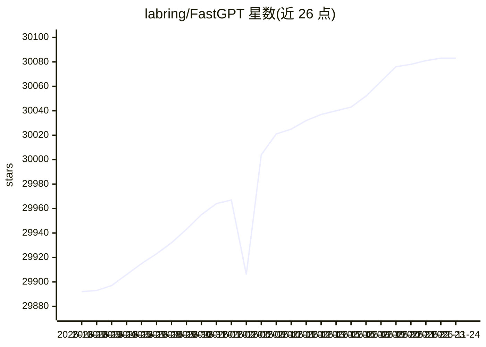

# labring/FastGPT

⭐ 30,083 · TypeScript · NOASSERTION · 推送 2026-11-22 · [GitHub](https://github.com/labring/FastGPT) · [官网](https://fastgpt.io) · 组织维护 · 中文 README

**基于 LLM 的知识库问答与可视化工作流构建平台**

FastGPT 是一个 AI Agent 构建平台，提供数据处理、模型调用、RAG 检索等开箱即用能力，并通过 Flow 可视化编排对话工作流与插件工作流。核心功能覆盖应用编排（含双向 MCP）、应用调试（调用链日志、应用评测）、知识库管理（多种文件格式导入、混合检索与重排）及运营能力（免登录分享、iframe 嵌入、对话标注）。支持 Docker 自托管、Sealos 一键部署与云服务版本，另设商业版提供完整软件与场景落地辅导。

## 筛选速览

| 维度 | 判定 | 备注 |
|---|---|---|
| AI 角色 | `ai-native` | 本体是模型或模型工具 |
| 许可风险 | `none` | NOASSERTION |
| 部署形态 | `self-host` | docker 或自建部署 |
| 模型依赖 | — | README 未给出锁定关系 |
| 硬件要求 | — | 无带数字的原话,不猜 |
| 安装摩擦 | `low` | 无编译、无系统依赖或容器化 |
| 成熟度 | — | 结构信号不足 |

## 动量与使用信号

- 维护:`active` — 距上次 push 1.9 天,年发版 79,191 位贡献者
- 涨星:近 1 天 **+7**(自 20261016 起算)
- 平台:— · 协议:MCP

## 能力要点

- Flow 可视化工作流编排，含 RPA 节点与双向 MCP
- 知识库支持 TXT/MD/HTML/PDF/Docx/PPTX/CSV/XLSX 导入与混合检索重排
- 应用调试提供完整调用链路日志与反馈引用修改
- 免登录分享窗口与 iframe 一键嵌入

## 适用场景

- 搭建企业知识库问答系统
- 可视化编排复杂的 AI 对话工作流
- 私有化部署 AI 应用并嵌入现有网站
- 管理多知识库并做检索测试与调用链审计

## 场景标签

`工作流自动化` `RAG` `文档问答` · 领域:效率与自动化

## 证据(README 行号)

> L12: FastGPT 是一个 AI Agent 构建平台，提供开箱即用的数据处理、模型调用等能力，同时可以通过 Flow 可视化进行工作流编排，从而实现复杂的应用场景。
> L62: `1` 应用编排能力
> L77: `3` 知识库能力

## 星数曲线

2026-10-22 29,892 → 2026-11-24 30,083（+191）

---
*卡片 v1 · prompt 1.4 · 生成 2026-11-22 · 置信度 high · 依据 README sha `fc78a101c6c4` · [字段定义](../../DATASET.md)*
