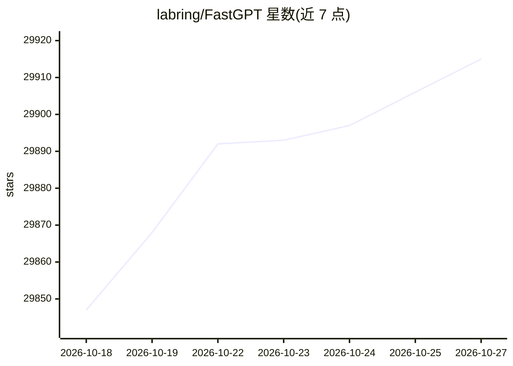

# labring/FastGPT

⭐ 29,915 · TypeScript · NOASSERTION · 推送 2026-10-26 · [GitHub](https://github.com/labring/FastGPT) · [官网](https://fastgpt.io) · 组织维护 · 中文 README

**知识库问答应用构建平台：可视化工作流编排 + RAG**

基于 LLM 的 AI Agent 构建平台，提供数据处理、RAG 检索、模型调用等开箱即用能力，并通过 Flow 可视化界面编排对话工作流与插件工作流。核心模块包括应用编排、应用调试（调用链路日志、应用评测）、知识库（多格式导入、混合检索与重排）、插件与运营（免登录分享、iframe 嵌入、对话记录标注）。支持云服务、Docker 自托管、Sealos 一键部署三种方式，另有商业版提供扩展功能与服务。

## 筛选速览

| 维度 | 判定 | 备注 |
|---|---|---|
| AI 角色 | `ai-native` | 本体是模型或模型工具 |
| 许可风险 | `dual` | NOASSERTION |
| 部署形态 | `self-host` | docker 或自建部署 |
| 模型依赖 | — | README 未给出锁定关系 |
| 硬件要求 | — | 无带数字的原话,不猜 |
| 安装摩擦 | `low` | 无编译、无系统依赖或容器化 |
| 成熟度 | — | 结构信号不足 |

## 动量与使用信号

- 维护:`active` — 距上次 push 1.9 天,年发版 79,191 位贡献者
- 涨星:近 1 天 **+7**(自 20261016 起算)
- 平台:— · 协议:MCP

## 能力要点

- Flow 可视化编排对话与插件工作流，含 RPA 节点与用户交互
- 知识库支持 TXT/MD/HTML/PDF/Docx/PPTX/CSV/XLSX 导入及 URL 读取
- 双向 MCP 支持与 Agent Skill 编排
- 混合检索 & 重排，对话可反馈引用并修改删除

## 适用场景

- 私有化部署企业知识库问答系统
- 可视化编排复杂 AI 对话应用工作流
- 搭建可嵌入网站的自助问答窗口
- 对知识库 chunk 与引用进行管理调试

## 场景标签

`RAG` `文档问答` `工作流自动化` · 领域:效率与自动化

## 证据(README 行号)

> L12: FastGPT 是一个 AI Agent 构建平台，提供开箱即用的数据处理、模型调用等能力，同时可以通过 Flow 可视化进行工作流编排，从而实现复杂的应用场景。
> L64:  - [x] 对话工作流、插件工作流，包含基础的 RPA 节点
> L78:  - [x] 多库复用，混用

## 星数曲线

2026-10-18 29,847 → 2026-10-27 29,915（+68）

---
*卡片 v1 · prompt 1.4 · 生成 2026-10-18 · 置信度 high · 依据 README sha `985288382b24` · [字段定义](../../DATASET.md)*
