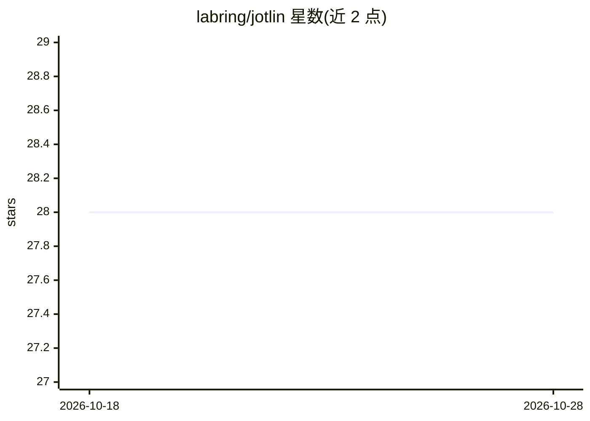

# labring/jotlin

⭐ 28 · TypeScript · 推送 2026-02-05 · [GitHub](https://github.com/labring/jotlin) · [官网](https://jotlin.ai) · 组织维护

**AI 规格文档助手：通过对话把想法生成为 PRD 与技术文档**

面向需要撰写需求文档的团队与个人的 Web 应用：用户用自然语言描述项目想法，AI 以结构化访谈方式提问并生成 PRD、用户故事、流程图、风险评估与技术文档，可迭代修订并保留会话上下文。技术栈为 Next.js 15 + React 19 全栈架构，AI 部分基于 Vercel AI SDK 接入 Anthropic Claude，支持流式输出；数据用 PostgreSQL + Prisma 持久化，认证采用 GitHub OAuth。安装需 Node.js 18+、PostgreSQL 14+，自部署流程含依赖安装、Prisma 迁移与环境变量配置，另提供 Docker 镜像构建与 Vercel 部署路径。

## 筛选速览

| 维度 | 判定 | 备注 |
|---|---|---|
| AI 角色 | `ai-native` | 本体是模型或模型工具 |
| 许可风险 | `none` | — |
| 部署形态 | `self-host` | docker 或自建部署 |
| 模型依赖 | locked-api |  |
| 硬件要求 | — | 无带数字的原话,不猜 |
| 安装摩擦 | `low` | 无编译、无系统依赖或容器化 |
| 成熟度 | — | 结构信号不足 |

## 能力要点

- AI 引导式访谈，从粗略想法生成 PRD、用户故事、流程图、风险评估与技术文档
- 对话式 UI，实时流式响应，跨会话保留上下文
- 工件可查看、编辑与迭代，GitHub OAuth 认证与 PostgreSQL 持久化
- 提供 Docker 构建、本地开发与 Vercel 三种部署方式

## 适用场景

- 不想从空白文档开始，用对话方式起草产品需求文档
- 让 AI 通过提问补全我容易遗漏的需求点
- 团队协作中持续迭代并沉淀规格文档

## 场景标签

`AI 写作` `AI 助手` · 领域:对话与助手

## 证据(README 行号)

> L12: Jotlin is an AI-powered specification assistant that transforms rough ideas into production-ready documentation thr
> L28: - **🎯 AI-Powered Interviews** - Intelligent questioning system that guides you from vague ideas to concrete specifi
> L29: - **📝 Multi-Format Artifacts** - Generate PRDs, user stories, flow diagrams, risk assessments, and technical docs

## 星数曲线

2026-10-18 28 → 2026-10-28 28（+0）

---
*卡片 v1 · prompt 1.4 · 生成 2026-10-26 · 置信度 high · 依据 README sha `5cc32ff3b2f2` · [字段定义](../../DATASET.md)*
