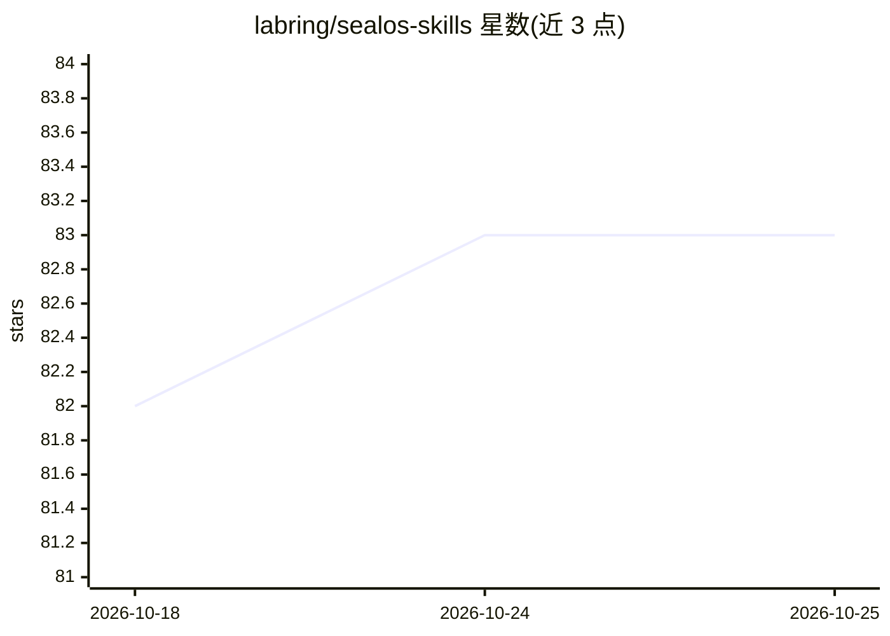

# labring/sealos-skills

⭐ 83 · Python · 推送 2026-09-28 · [GitHub](https://github.com/labring/sealos-skills) · [官网](https://sealos.io/sealos-skills) · 组织维护 · 中文 README

**让 AI agent 一句话把项目部署到 Sealos 云的技能插件**

以 Agent Plugins 格式与 DeepSeek Harness profile bundle 打包的 Sealos 云部署技能（use-sealos），可安装到 Claude Code、Codex、Cursor、Gemini CLI、Qwen Code、Qoder、OpenClaw、CodeBuddy 等宿主。用户说"deploy X to Sealos"后，技能完成登录（OAuth2 设备流或 kubeconfig）、数据库/存储开通、公网 HTTPS 与部署后验证。部署走三条路径：200+ 模板商店、官方 Docker 镜像生成模板、源码构建（Kaniko）；均经 Sealos Template API 记为可整体删除的实例。运行需 kubectl 与 python3，源码路径另需 docker 和 gh，并需 Sealos 账号。

## 筛选速览

| 维度 | 判定 | 备注 |
|---|---|---|
| AI 角色 | `ai-ecosystem` | LLM/agent 周边工具 |
| 许可风险 | `none` | — |
| 部署形态 | `self-host` | docker 或自建部署 |
| 模型依赖 | locked-api |  |
| 硬件要求 | — | 无带数字的原话,不猜 |
| 安装摩擦 | `low` | 无编译、无系统依赖或容器化 |
| 成熟度 | — | 结构信号不足 |

## 能力要点

- use-sealos 技能覆盖登录、选路径、数据库/存储、HTTPS 与部署后验证
- 三条部署路径：模板商店（约3分钟）/Docker镜像模板/源码构建
- 支持 10+ agent 宿主安装（Claude Code、Codex、Cursor、Gemini CLI 等）
- 依赖仅 kubectl 与 python3 标准库

## 适用场景

- 在 Claude Code 或 Codex 里说一句话把应用部署到 Sealos 云
- 部署时一并开通数据库、对象存储与公网 HTTPS
- 把自有项目源码构建成镜像并部署到 Sealos

## 场景标签

 · 领域:云原生/DevOps 工具

## 证据(README 行号)

> L3: Agent plugin for deploying and operating apps on Sealos Cloud,
> L10: Say "deploy X to Sealos" (or "帮我把 X 部署到 Sealos") in a compatible agent
> L87: `use-sealos` appears in the session skill catalog. Say "deploy X to Sealos"; the model loads the skill via the `ski

## 星数曲线

2026-10-18 82 → 2026-10-25 83（+1）

---
*卡片 v1 · prompt 1.4 · 生成 2026-10-24 · 置信度 mid · 依据 README sha `2fe3a68f2058` · [字段定义](../../DATASET.md)*
