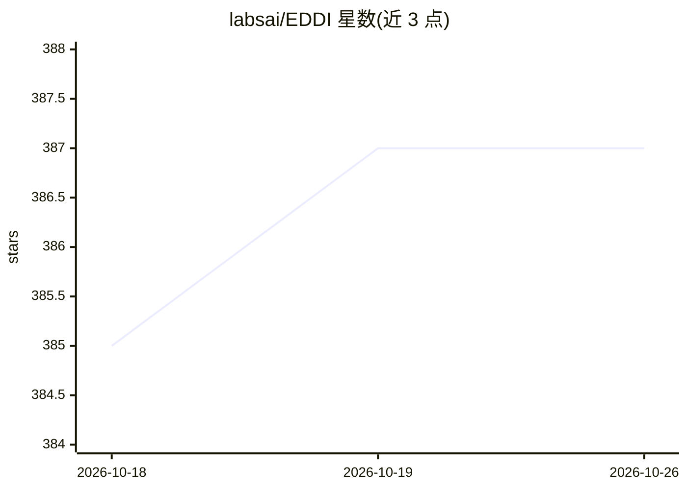

# labsai/EDDI

⭐ 387 · Java · Apache-2.0 · 推送 2026-10-25 · [GitHub](https://github.com/labsai/EDDI) · [官网](https://eddi.technology) · 组织维护

**面向生产环境的对话式 AI 多智能体编排中间件**

EDDI 是用 Java 25 与 Quarkus 构建的配置驱动多智能体编排中间件：通过 JSON 配置而非代码定义智能体，提供智能路由、多智能体群组讨论（7 种讨论风格、投票、协商、共享黑板等）、持久记忆、MCP/A2A 协议支持、RAG、密钥保险库、租户配额与合规基础设施（GDPR/HIPAA/EU AI Act）。以 Red Hat 认证 Docker 镜像发布，内置 Manager 管理面板与聊天 UI，支持一键安装脚本、Docker Compose 与 Kubernetes/OpenShift 部署，可选接入 Ollama 本地模型、Keycloak 认证与 Prometheus/Grafana 监控。面向需要治理与审计的生产级智能体部署场景。

## 筛选速览

| 维度 | 判定 | 备注 |
|---|---|---|
| AI 角色 | `ai-ecosystem` | LLM/agent 周边工具 |
| 许可风险 | `permissive` | Apache-2.0 |
| 部署形态 | `self-host` | docker 或自建部署 |
| 模型依赖 | local-ok | 支持本地模型 |
| 硬件要求 | — | 无带数字的原话,不猜 |
| 安装摩擦 | `low` | 无编译、无系统依赖或容器化 |
| 成熟度 | — | 结构信号不足 |

## 能力要点

- JSON 版本化配置定义智能体，无动态代码执行
- 群组对话含 7 种讨论风格、投票、协商与共享黑板
- 支持 MCP、A2A、OpenAI Chat Completions、Slack 接入
- HMAC-SHA256 不可变审计账本与信封加密密钥保险库

## 适用场景

- 在生产环境以配置方式编排多智能体对话系统
- 将智能体部署到 Slack 并运行多智能体讨论
- 企业场景下按 GDPR/HIPAA/EU AI Act 要求治理 AI 智能体
- 通过 Docker Compose 一键搭建含本地 Ollama 模型的智能体栈

## 场景标签

`多智能体` `RAG` · 领域:Agent 开发

## 证据(README 行号)

> L11: **E.D.D.I** (Enhanced Dialog Driven Interface) is a production-grade, **config-driven multi-agent orchestration mid
> L13: Built with **Java 25** and **Quarkus**. Ships as a **Red Hat-certified Docker image** with the **Manager dashboard 
> L125: Most multi-agent frameworks (LangGraph, CrewAI, AutoGen) are Python/Node libraries — great for prototyping, hard t

## 星数曲线

2026-10-18 385 → 2026-10-26 387（+2）

---
*卡片 v1 · prompt 1.4 · 生成 2026-10-21 · 置信度 high · 依据 README sha `b723a9c3fe0b` · [字段定义](../../DATASET.md)*
