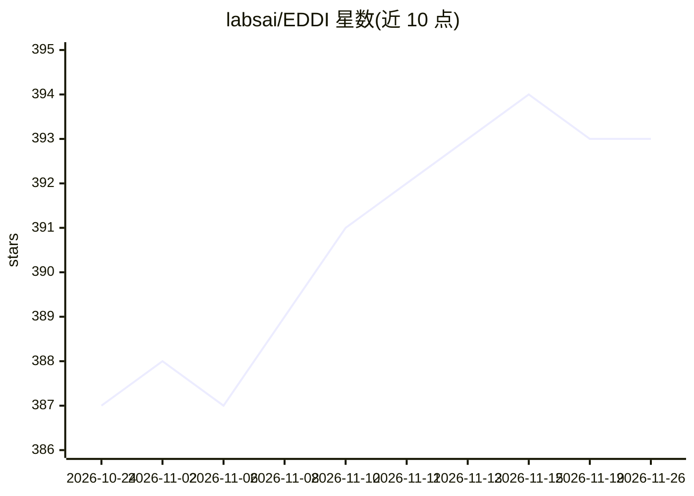

# labsai/EDDI

⭐ 393 · Java · Apache-2.0 · 推送 2026-11-25 · [GitHub](https://github.com/labsai/EDDI) · [官网](https://eddi.technology) · 组织维护

**自托管 AI 代理管理服务器：运行、限制、审批并记录代理行为**

一个部署在自己服务器上的 AI 代理管理服务：代理以版本化 JSON 配置定义（模型、提示词、工具、知识、审批点），一个 Docker 镜像提供 REST API、管理后台与聊天界面。支持 19 家模型提供商与本地模型、多代理群组、RAG、持久记忆、每步 HMAC 签名的审计账本、人工审批门（Manager/Slack/MCP）、速率与成本预算，并内置 GDPR/CCPA 删除导出。面向需要在自有基础设施上以受治理方式运行代理的企业与开发者。

## 筛选速览

| 维度 | 判定 | 备注 |
|---|---|---|
| AI 角色 | `ai-ecosystem` | LLM/agent 周边工具 |
| 许可风险 | `permissive` | Apache-2.0 |
| 部署形态 | `self-host` | docker 或自建部署 |
| 模型依赖 | local-ok | 支持本地模型 |
| 硬件要求 | — | 无带数字的原话,不猜 |
| 安装摩擦 | `low` | 无编译、无系统依赖或容器化 |
| 成熟度 | — | 结构信号不足 |

## 能力要点

- 代理即版本化 JSON 配置，可 diff、导出 ZIP、跨实例同步
- 19 家模型提供商含本地 Ollama，支持 OpenAI 兼容端点
- MCP 服务器（120 工具）与 MCP 客户端、A2A、OpenAI 兼容 /v1 API
- append-only 审计账本（HMAC 签名）与每轮/每工具调用的人工审批门

## 适用场景

- 在自有服务器上运行受限且可审计的 AI 代理团队
- 让已有 Claude/Cursor 等 MCP 助手代为创建和管理代理
- 为需要人工审批与合规留痕的代理决策加治理层

## 场景标签

`Agent 框架` `多智能体` `RAG` · 领域:Agent 开发

## 证据(README 行号)

> L11: **The open-source AI agent management system.** Run teams of AI agents on your own infrastructure, limit what they 
> L129: |🧠 **LLMs**|19 providers, among them OpenAI, Anthropic, Gemini, Mistral, Azure OpenAI, Bedrock, Vertex AI and Olla
> L133: |🔗 **Protocols**|MCP server, A2A, an OpenAI-compatible API, SSE streaming, Slack|MCP server · A2A · OpenAI-compati

## 星数曲线

2026-10-24 387 → 2026-11-26 393（+6）

---
*卡片 v1 · prompt 1.4 · 生成 2026-11-25 · 置信度 high · 依据 README sha `a10507381cab` · [字段定义](../../DATASET.md)*
