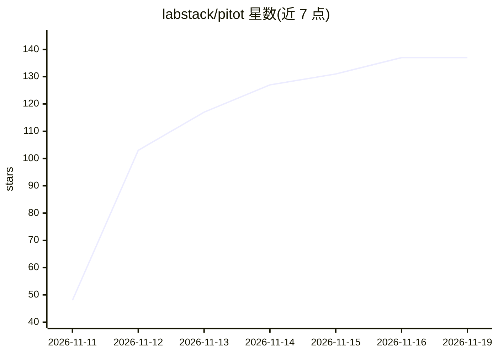

# labstack/pitot

⭐ 137 · Go · Apache-2.0 · 推送 2026-11-18 · [GitHub](https://github.com/labstack/pitot) · [官网](https://pitot.dev) · 组织维护

**单二进制可观测性平台：接收 OTLP，内置 AI 调查代理**

Pitot 将 OpenTelemetry 的 traces、日志与指标接入一个二进制与一个数据目录，无需外部存储服务：OTLP 经 gRPC/HTTP 接入后落为 Parquet，用 DuckDB 做查询分析，并提供 PitotQL、仪表盘与告警。面向自托管运维/开发者，内置调查代理可用自然语言问答遥测数据（可选接入 Anthropic 或 OpenAI，不配置则聊天禁用而其余功能可用），并暴露 MCP 服务端供外部 agent 使用相同查询工具。限制：单节点、无集群与复制，处于 alpha 预发布阶段且无迁移保证。

## 筛选速览

| 维度 | 判定 | 备注 |
|---|---|---|
| AI 角色 | `ai-enhanced` | 去掉 AI 部分产品仍成立 |
| 许可风险 | `permissive` | Apache-2.0 |
| 部署形态 | `self-host` | docker 或自建部署 |
| 模型依赖 | — | README 未给出锁定关系 |
| 硬件要求 | — | 无带数字的原话,不猜 |
| 安装摩擦 | `low` | 无编译、无系统依赖或容器化 |
| 成熟度 | `idea` | |

## 能力要点

- 单二进制单数据目录承载 ingest、存储、查询、告警、agent、MCP 与 React 客户端
- OTLP gRPC/HTTP 接入，Parquet 存储 + DuckDB 分析
- 内置自然语言调查代理与 MCP 服务端（Streamable HTTP，OAuth 授权）
- AI 聊天为可选：PITOT_AI_PROVIDER 支持 anthropic/openai，不配置则其余功能照常

## 适用场景

- 自托管采集与调查 OpenTelemetry 三类信号，不想运维外部存储
- 让 AI 代理通过 MCP 用同一查询契约调查遥测数据
- 在单机磁盘与 CPU 预算内做事故调查与告警

## 场景标签

`LLM 可观测性` · 领域:评测与运维

## 证据(README 行号)

> L26: - OTLP ingest over gRPC and HTTP, with local Parquet storage and DuckDB analytics.
> L28: - An investigation agent that answers questions about your telemetry in plain language.
> L97: requires its key at startup. With no provider, chat is disabled and the other features still work.

## 星数曲线

2026-11-11 48 → 2026-11-19 137（+89）

---
*卡片 v1 · prompt 1.4 · 生成 2026-11-17 · 置信度 high · 依据 README sha `07cc4837e4e7` · [字段定义](../../DATASET.md)*
