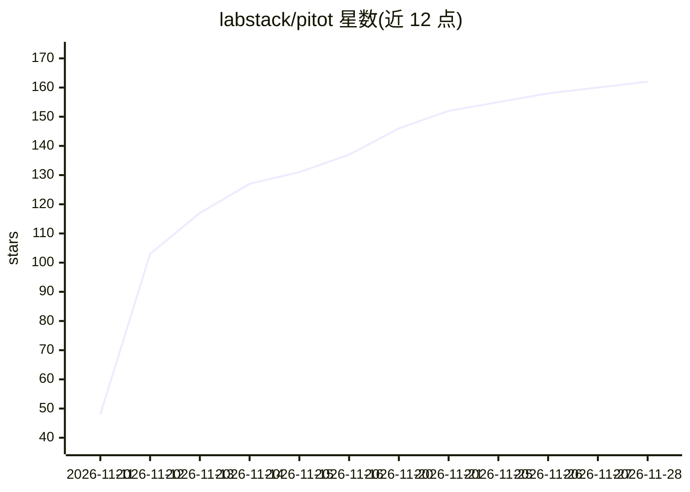

# labstack/pitot

⭐ 162 · Go · Apache-2.0 · 推送 2026-11-25 · [GitHub](https://github.com/labstack/pitot) · [官网](https://pitot.dev) · 组织维护

**单二进制可观测性平台：接收 OTLP 并以 DuckDB 查询**

Pitot 将 OpenTelemetry 的 traces、logs、metrics 接收（OTLP/gRPC 与 HTTP）并存入本地 Parquet，用 DuckDB 做查询分析，全部打包为一个 Go 二进制加一个数据目录，无外部存储服务。提供 PitotQL 查询语言（无需 AI 提供商）、内置调查 agent、MCP server（供外部 agent 连接）、跨三信号的仪表盘与服务错误率/延迟等告警。配置仅通过环境变量，修改需重启。定位单节点：无集群、无复制、无对象存储层。当前为 pre-release/alpha，接口可能无迁移路径地变动。

## 筛选速览

| 维度 | 判定 | 备注 |
|---|---|---|
| AI 角色 | `ai-enhanced` | 去掉 AI 部分产品仍成立 |
| 许可风险 | `permissive` | Apache-2.0 |
| 部署形态 | `self-host` | docker 或自建部署 |
| 模型依赖 | — | README 未给出锁定关系 |
| 硬件要求 | — | 无带数字的原话,不猜 |
| 安装摩擦 | `low` | 无编译、无系统依赖或容器化 |
| 成熟度 | `idea` | |

## 能力要点

- OTLP/gRPC 与 HTTP 接收，本地 Parquet 存储 + DuckDB 分析
- 内置调查 agent 与 MCP server，供外部 agent 以自然语言查询遥测
- PitotQL/Explore 查询不依赖 AI 提供商
- 一个二进制 + 一个数据目录，单进程含接收、存储、查询、告警、MCP 与 React 客户端

## 适用场景

- 自托管接收并查询 OpenTelemetry 遥测数据
- 通过 MCP 让外部 agent 以自然语言调查服务故障
- 在单机环境中替代多组件遥测栈的部署方式

## 场景标签

 · 领域:可观测性/监控运维

## 证据(README 行号)

> L20: Pitot keeps OpenTelemetry traces, logs, and metrics in one binary and one data directory, with no
> L28: - An investigation agent that answers questions about your telemetry in plain language.
> L29: - An MCP server for external agents using the same typed query tools.

## 星数曲线

2026-11-11 48 → 2026-11-28 162（+114）

---
*卡片 v1 · prompt 1.4 · 生成 2026-11-27 · 置信度 high · 依据 README sha `13a3db73db8f` · [字段定义](../../DATASET.md)*
