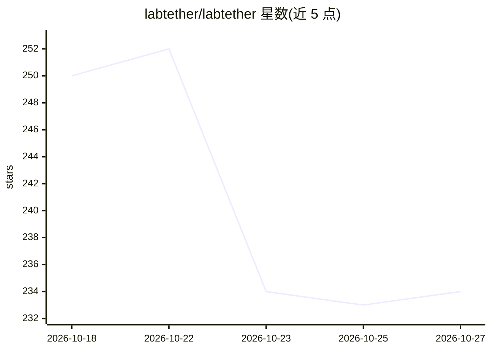

# labtether/labtether

⭐ 234 · Go · Apache-2.0 · 推送 2026-10-26 · [GitHub](https://github.com/labtether/labtether) · [官网](https://labtether.com) · 组织维护

**自托管家庭实验室统一管控面板，内置 MCP 供 AI agent 运维**

用 Go 编写的跨平台 homelab 控制平面：单一仪表盘聚合 Proxmox、TrueNAS、Docker、Portainer、Home Assistant 等设施的指标、日志、告警与事件，并提供浏览器远程终端/桌面、文件管理、拓扑图、自动化任务与 Webhook。安全方面内置 Tailscale 集成、2FA、OIDC/SSO、RBAC 与审计日志。AI 部分为内置 MCP 服务器（23+ 工具），可接入 Claude、Cursor 等 agent 用自然语言操作基础设施。通过 curl 校验安装脚本加 Docker Compose 部署，可选 Linux/macOS/Windows 端点 agent；Windows 支持部分功能，FreeBSD 计划中。

## 筛选速览

| 维度 | 判定 | 备注 |
|---|---|---|
| AI 角色 | `ai-enhanced` | 去掉 AI 部分产品仍成立 |
| 许可风险 | `permissive` | Apache-2.0 |
| 部署形态 | `self-host` | docker 或自建部署 |
| 模型依赖 | — | README 未给出锁定关系 |
| 硬件要求 | — | 无带数字的原话,不猜 |
| 安装摩擦 | `low` | 无编译、无系统依赖或容器化 |
| 成熟度 | — | 结构信号不足 |

## 能力要点

- 内置 MCP 服务器（23+ 工具），接入 Claude/Cursor 等 agent 自然语言运维
- 统一仪表盘聚合指标、日志、告警、事件与拓扑图
- 集成 Proxmox VE/TrueNAS/Docker/Portainer/Home Assistant 等并自动发现
- 2FA、OIDC/SSO、RBAC、审计日志与 Tailscale 远程访问

## 适用场景

- 用多个仪表盘管理 Proxmox/TrueNAS/Docker，想合并到一处查看与操作
- 让 AI agent 通过自然语言重启容器、读日志、执行命令
- 家庭实验室需要安全的远程终端、文件管理与告警

## 场景标签

 · 领域:基础设施运维/自托管

## 证据(README 行号)

> L5: **Cross-platform homelab control plane with AI-powered operations.**
> L39: - **Self-hosted** -- Docker Compose + Postgres. Your data never leaves your network.

## 星数曲线

2026-10-18 250 → 2026-10-27 234（-16）

---
*卡片 v1 · prompt 1.4 · 生成 2026-10-22 · 置信度 high · 依据 README sha `66bf46727a09` · [字段定义](../../DATASET.md)*
