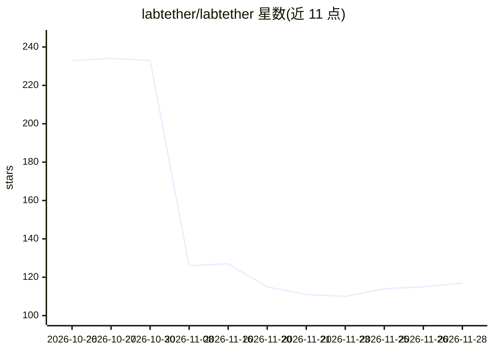

# labtether/labtether

⭐ 117 · Go · Apache-2.0 · 推送 2026-11-17 · [GitHub](https://github.com/labtether/labtether) · [官网](https://labtether.com) · 组织维护

**给 homelab 用户的自托管统一监控管理中枢**

面向已运行 Proxmox、TrueNAS、Docker、Home Assistant 等多套系统的 homelab 用户，把节点、VM、容器、告警与日志聚合到一个自托管网页面板：支持浏览器内终端与远程桌面（VNC/RDP/SPICE/WebRTC）、告警规则与事件追踪、文件传输、日志搜索、批量软件更新（带 dry run）、依赖关系拓扑图和定时/分组自动化任务。通过连接器（API key，无需在被管机器装东西）或 Agent（提供实时指标与操作能力）接入设备。内置 MCP server 向 Claude、Cursor 等 MCP 客户端提供 32 个工具。安全方面提供 HTTPS、2FA、OIDC 单点登录、角色权限与审计日志，随 Docker Compose 部署，Apache 2.0 许可。

## 筛选速览

| 维度 | 判定 | 备注 |
|---|---|---|
| AI 角色 | `ai-enhanced` | 去掉 AI 部分产品仍成立 |
| 许可风险 | `permissive` | Apache-2.0 |
| 部署形态 | `self-host` | docker 或自建部署 |
| 模型依赖 | — | README 未给出锁定关系 |
| 硬件要求 | — | 无带数字的原话,不猜 |
| 安装摩擦 | `low` | 无编译、无系统依赖或容器化 |
| 成熟度 | — | 结构信号不足 |

## 能力要点

- 通过连接器（API key）接入 Proxmox VE、PBS、TrueNAS、Portainer、Home Assistant
- 浏览器内终端与远程桌面（VNC/RDP/SPICE/WebRTC），Agent 节点无需 SSH key
- 内置 MCP server，向 MCP 客户端提供 32 个 homelab 工具并按 API key 划定作用域
- HTTPS、2FA、OIDC、四种角色与审计日志的默认安全配置

## 适用场景

- 把多台 Proxmox/TrueNAS/Docker 主机的监控、告警和日志收进一个面板
- 在浏览器里直接开终端或远程桌面操作任一节点
- 给 AI Agent（如 Claude）授予受限工具集来管理 homelab
- 按计划在机器分组上批量执行命令和软件更新

## 场景标签

 · 领域:基础设施/DevOps 自托管工具

## 证据(README 行号)

> L5: **One self-hosted hub for every machine, VM and container in your homelab.**
> L40: - **Ask your AI agent.** The built-in MCP server gives Claude, Cursor or any MCP
> L46: - **Open source.** The hub is Apache 2.0 and runs with Docker Compose.

## 星数曲线

2026-10-26 233 → 2026-11-28 117（-116）

---
*卡片 v1 · prompt 1.4 · 生成 2026-11-28 · 置信度 high · 依据 README sha `b3887719412c` · [字段定义](../../DATASET.md)*
