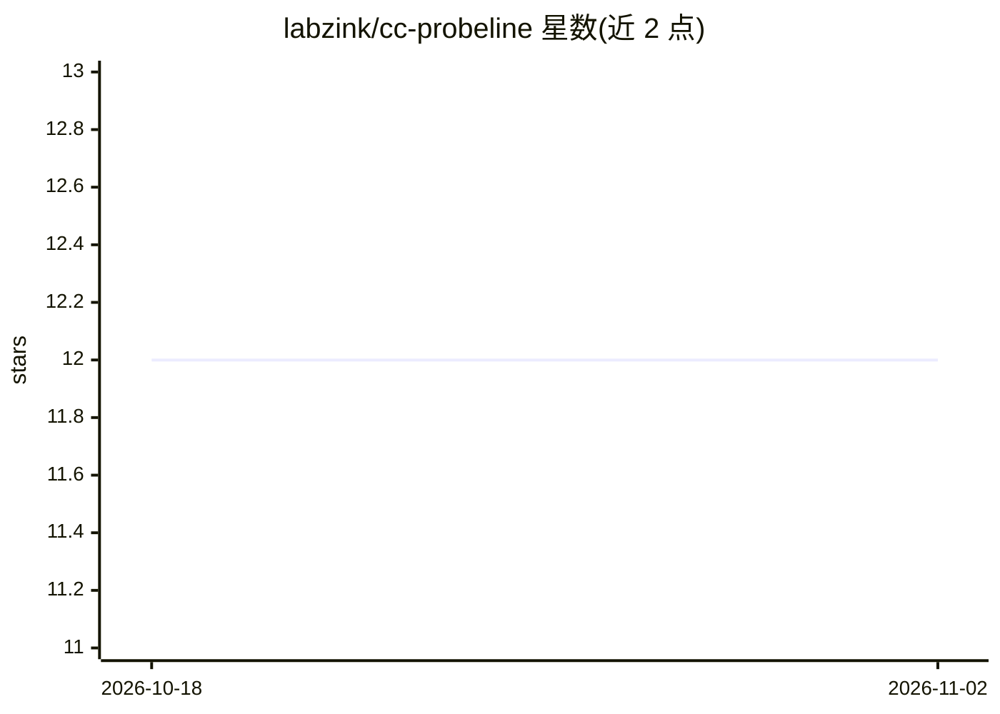

# labzink/cc-probeline

⭐ 12 · Go · MIT · 推送 2026-08-12 · [GitHub](https://github.com/labzink/cc-probeline) · [官网](https://github.com/labzink/cc-probeline) · 个人维护

**给 Claude Code 用户的成本监控状态栏：为每轮对话实时标价**

单文件 Go 二进制，作为 Claude Code 的 status line 插件运行：读取本地会话 JSONL 日志与 status-line payload，按公开价格表估算每轮对话、子代理与缓存重建的费用，并显示 5h/7d 配额、上下文与 git 信息。渲染全程离线，仅有的网络行为是每日一次可关闭的价格/版本检查与可选的 Claude Code usage 缓存刷新，不发送会话数据。支持 Homebrew/curl/Scoop/插件市场四种安装通道，配额段需 Claude Code ≥ 2.1.80。费用为估算值，月度超额数字来自 Anthropic 自身数据。

## 筛选速览

| 维度 | 判定 | 备注 |
|---|---|---|
| AI 角色 | `ai-ecosystem` | LLM/agent 周边工具 |
| 许可风险 | `permissive` | MIT |
| 部署形态 | `None` |  |
| 模型依赖 | — | README 未给出锁定关系 |
| 硬件要求 | — | 无带数字的原话,不猜 |
| 安装摩擦 | `low` | 无编译、无系统依赖或容器化 |
| 成熟度 | `idea` | |

## 能力要点

- 逐轮定价表，含 orchestrator 与 subagent 行、缓存重建美元计价
- 5h/7d 配额与重置倒计时、超额实付金额展示
- 单文件 Go 二进制，渲染离线，无遥测，运行约 5ms
- /cc-probeline-config 交互式配置向导，TOML 三级优先级

## 适用场景

- 查看 Claude Code 会话中每一轮和子代理花了多少钱
- 临近 5h/7d 配额上限时收到颜色分级提醒
- 捕捉缓存过期后的重建成本
- 掌握本月超额使用实付金额与上限距离

## 场景标签

`LLM 可观测性` · 领域:评测与运维

## 证据(README 行号)

> L8: A status line for Claude Code that prices every turn — yours, your subagents', and every cache rebuild — reading the
> L60: - **What it reads:** your session's JSONL log (`~/.claude/projects/…`) and the status-line payload Claude Code pipe
> L62: - **The binary:** single compiled Go binary, no runtime dependencies, one run ≈ 5 ms.

## 星数曲线

2026-10-18 12 → 2026-11-02 12（+0）

---
*卡片 v1 · prompt 1.4 · 生成 2026-11-01 · 置信度 high · 依据 README sha `395f251a7da8` · [字段定义](../../DATASET.md)*
