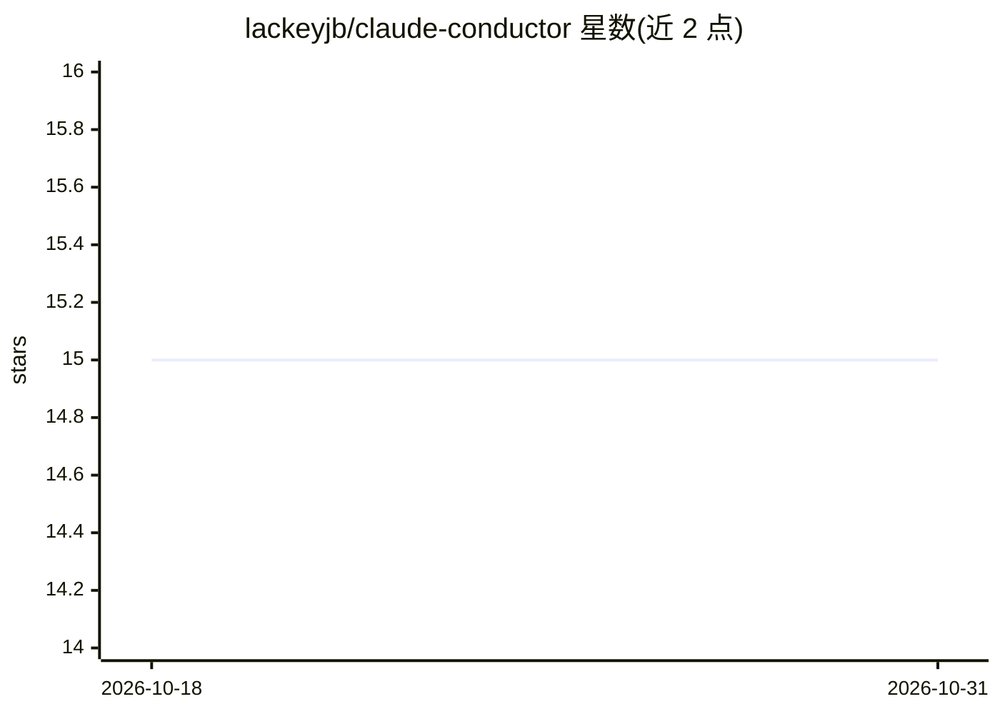

# lackeyjb/claude-conductor

⭐ 15 · JavaScript · Apache-2.0 · 推送 2025-12-30 · [GitHub](https://github.com/lackeyjb/claude-conductor) · 个人维护

**Claude Code 的上下文驱动开发框架插件**

面向 Claude Code 的插件，实现 Context-Driven Development 方法论：将上下文作为与代码并列的管理物。提供 setup、new-track、implement、status、agents、revert 六个命令；通过 planner、implementer、reviewer 三个子代理执行规划与 TDD 红绿重构循环，用 git worktree 隔离并行代理，按 track/phase/task 维度做 git 感知回滚，并强制测试覆盖率、风格、lint 等质量门禁。安装方式为 Claude Code 插件目录加载、marketplace 安装或符号链接，项目需为 git 仓库并已配置测试框架。

## 筛选速览

| 维度 | 判定 | 备注 |
|---|---|---|
| AI 角色 | `ai-ecosystem` | LLM/agent 周边工具 |
| 许可风险 | `permissive` | Apache-2.0 |
| 部署形态 | `None` |  |
| 模型依赖 | — | README 未给出锁定关系 |
| 硬件要求 | — | 无带数字的原话,不猜 |
| 安装摩擦 | `low` | 无编译、无系统依赖或容器化 |
| 成熟度 | — | 结构信号不足 |

## 能力要点

- planner/implementer/reviewer 三子代理分工，强制 Red-Green-Refactor TDD 循环
- git worktree 隔离的并行后台代理执行与自动合并
- track/phase/task 粒度的 git 感知回滚（/conductor:revert）
- plan.md 单一事实来源与 SessionStart 钩子自动恢复进度

## 适用场景

- 在 Claude Code 中以规格先行的 TDD 流程开发功能
- 并行运行多个实现代理且避免 git 冲突
- 按逻辑工作单元回滚已完成任务或阶段

## 场景标签

`编码 Agent` `多智能体` · 领域:Agent 开发

## 证据(README 行号)

> L3: Context-Driven Development framework for Claude Code.
> L418: Conductor uses Claude Code's plugin system:

## 星数曲线

2026-10-18 15 → 2026-10-31 15（+0）

---
*卡片 v1 · prompt 1.4 · 生成 2026-10-30 · 置信度 high · 依据 README sha `734daac3172b` · [字段定义](../../DATASET.md)*
