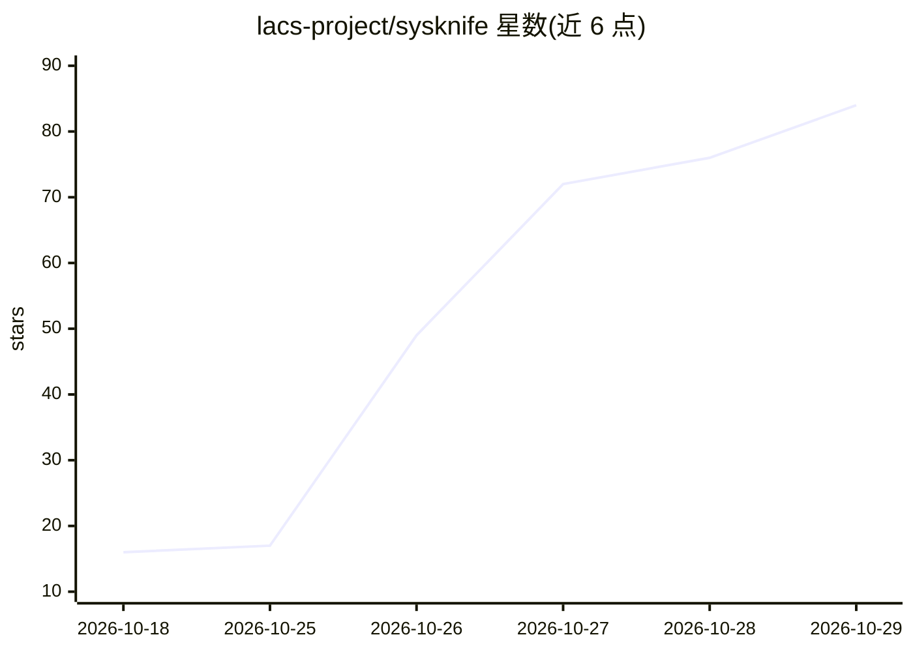

# lacs-project/sysknife

⭐ 84 · Rust · MIT · 推送 2026-10-27 · [GitHub](https://github.com/lacs-project/sysknife) · [官网](https://lacs-project.github.io/sysknife/) · 组织维护

**审批门控的 Linux 管理 MCP 服务器：AI 规划、人类批准、守护进程执行**

面向 Linux 系统管理的 MCP 服务器与 CLI：LLM 将自然语言请求转换为带风险等级的类型化动作计划，用户在终端用一次性回执显式批准，特权守护进程自行构建命令行并执行，全部动作写入 Ed25519 签名的哈姆链审计日志（SQLite/Postgres），可用 sysknife audit verify 校验。AI 不直接提供 shell 命令，也无法自行批准计划。支持 Ubuntu 20.04+，Fedora Atomic 走 rpm-ostree 且失败自动回滚；Fedora Workstation/Server 仍为实验性。默认 npx 安装器下载预编译二进制，也可从源码构建（需 Rust 与 C 编译器）。

## 筛选速览

| 维度 | 判定 | 备注 |
|---|---|---|
| AI 角色 | `ai-ecosystem` | LLM/agent 周边工具 |
| 许可风险 | `permissive` | MIT |
| 部署形态 | `library` | 以包/库形式分发 |
| 模型依赖 | local-ok | 支持本地模型 |
| 硬件要求 | — | 无带数字的原话,不猜 |
| 安装摩擦 | `medium` | 含编译或系统依赖之一 |
| 成熟度 | `idea` | |

## 能力要点

- AI 只发出类型化动作，命令行由守护进程从动作定义构建
- 终端一次性回执批准门：缺失/过期/重放回执均拒绝
- Ed25519 签名哈姆链审计日志，支持 SQLite/Postgres 与校验命令
- rpm-ostree 原子主机变更失败自动回滚

## 适用场景

- 让 Claude Code/Cursor/Codex CLI 等客户端以受控方式执行系统管理操作
- 审计 AI 代理在服务器上做过的每一项变更
- 通过 CLI 以自然语言规划并审批 Linux 运维任务

## 场景标签

 · 领域:系统管理/DevOps

## 证据(README 行号)

> L63: SysKnife is an MCP server first. Point Claude Code, Cursor or Codex CLI at it and
> L83: **Your assistant cannot approve its own work.** `sysknife_plan` hands back a

## 星数曲线

2026-10-18 16 → 2026-10-29 84（+68）

---
*卡片 v1 · prompt 1.4 · 生成 2026-10-26 · 置信度 high · 依据 README sha `7ca529c315a1` · [字段定义](../../DATASET.md)*
