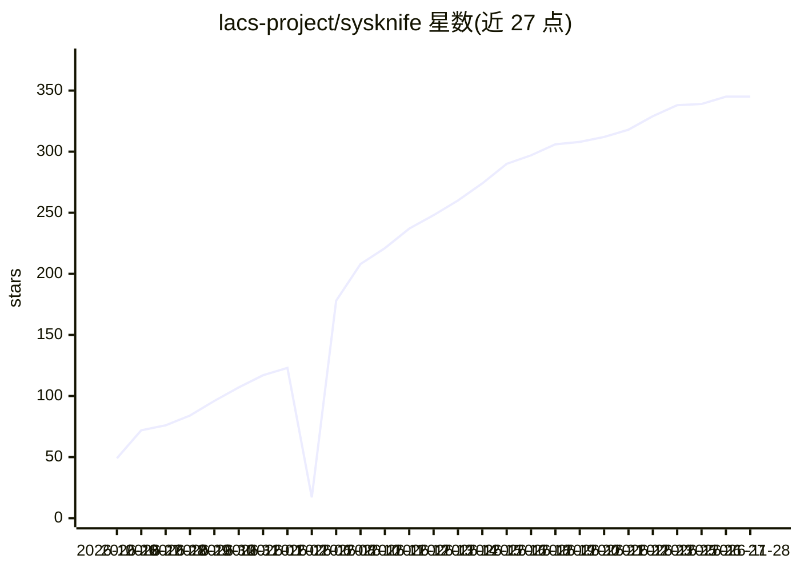

# lacs-project/sysknife

⭐ 345 · Rust · MIT · 推送 2026-11-27 · [GitHub](https://github.com/lacs-project/sysknife) · [官网](https://lacs-project.github.io/sysknife/) · 组织维护

**经审批与审计的 Linux 系统管理 MCP 服务器**

SysKnife 将 Linux 系统管理操作封装为带风险等级的类型化动作，通过 MCP 服务器接入 Claude Code、Cursor、Codex CLI，也提供独立 CLI。模型只生成类型化动作，命令由守护进程按动作定义构建；执行需用户在终端签发一次性回执批准，动作以 Ed25519 签名写入防篡改审计链，Fedora Atomic 主机变更失败自动回滚。需 Node 22+，默认下载预编译二进制；Tauri 桌面 GUI 开发已暂停。

## 筛选速览

| 维度 | 判定 | 备注 |
|---|---|---|
| AI 角色 | `ai-enhanced` | 去掉 AI 部分产品仍成立 |
| 许可风险 | `permissive` | MIT |
| 部署形态 | `desktop` | 安装包/桌面程序 |
| 模型依赖 | local-ok | 支持本地模型 |
| 硬件要求 | — | 无带数字的原话,不猜 |
| 安装摩擦 | `medium` | 含编译或系统依赖之一 |
| 成熟度 | — | 结构信号不足 |

## 能力要点

- 类型化动作机制：模型不生成命令，命令由守护进程从动作定义构建
- 终端侧一次性回执审批，AI 客户端无法自批自执行
- Ed25519 签名的防篡改审计链与 sysknife_audit_verify 校验
- npx sysknife-setup 一条命令安装守护进程并写入客户端 MCP 配置

## 适用场景

- 让 AI 助手以受控方式执行服务器运维（装包、防火墙、服务管理）
- 需要每次系统变更留有可验证审计记录的场景
- 在 Fedora Atomic/rpm-ostree 主机上自动化且可回滚的系统变更

## 场景标签

 · 领域:系统管理/DevOps 工具

## 证据(README 行号)

> L48: The AI never supplies a command. Every action is a **typed operation** with a
> L52: your system directly. A privileged daemon executes only what you approve, writes
> L65: SysKnife is an MCP server first. Point Claude Code, Cursor or Codex CLI at it and

## 星数曲线

2026-10-26 49 → 2026-11-28 345（+296）

---
*卡片 v1 · prompt 1.4 · 生成 2026-11-25 · 置信度 mid · 依据 README sha `7ff26ba29d57` · [字段定义](../../DATASET.md)*
