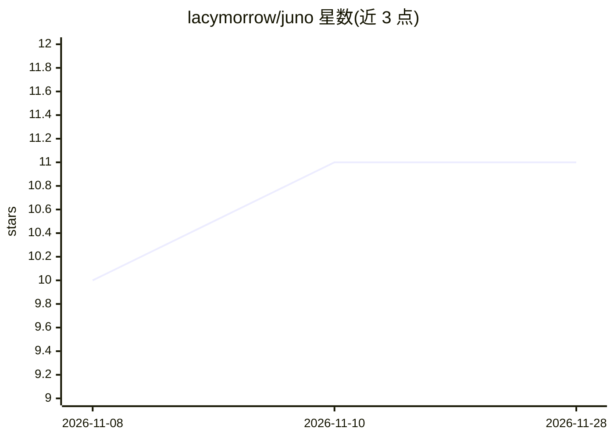

# lacymorrow/juno

⭐ 11 · Rust · NOASSERTION · 推送 2026-11-27 · [GitHub](https://github.com/lacymorrow/juno) · [官网](https://junebug.ai) · 个人维护

**让 AI 控制你 Mac 的桌面自动化应用：描述任务即可自动执行**

基于 Tauri/Rust 的原生 macOS 桌面应用，调用 Anthropic Computer Use API 使 Claude 获得屏幕视觉与鼠标键盘控制能力，按自然语言或语音指令自主完成任务。内部采用多 agent 编排（Desktop/Browser/File 三个专职 agent 由 orchestrator 分发并行执行），语音经本地 Whisper 转写，支持 MCP 扩展自定义工具，并提供 juno-cua CLI 让 Claude Code、Cursor 等编码 agent 经 MCP 操控桌面。仅支持 macOS 14+，含五级权限与审计日志等安全控制。

## 筛选速览

| 维度 | 判定 | 备注 |
|---|---|---|
| AI 角色 | `ai-native` | 本体是模型或模型工具 |
| 许可风险 | `none` | NOASSERTION |
| 部署形态 | `desktop` | 安装包/桌面程序 |
| 模型依赖 | locked-api |  |
| 硬件要求 | — | 无带数字的原话,不猜 |
| 安装摩擦 | `low` | 无编译、无系统依赖或容器化 |
| 成熟度 | — | 结构信号不足 |

## 能力要点

- 基于 Anthropic Computer Use API 的屏幕视觉与鼠标键盘控制
- 多 agent 并行编排：Desktop/Browser/File 三个专职 agent
- 本地 Whisper 语音转写，支持自定义唤醒词，99+ 语言
- juno-cua CLI 通过 MCP 为编码 agent 提供桌面控制工具

## 适用场景

- 用一句话完成填表、下载整理发票等工作流程
- 跨应用操作：打开 Figma 导出图片并上传 Slack
- 让 Claude Code/Cursor 等编码 agent 接管桌面截图与点击

## 场景标签

`GUI 自动化` `多智能体` `工作流自动化` · 领域:Agent 开发

## 证据(README 行号)

> L20: Juno is a native macOS desktop app that gives AI full control of your computer. It uses Anthropic's Computer Use to
> L99: Juno uses Anthropic's Computer Use API to give Claude vision and control of your screen. The orchestrator breaks co

## 星数曲线

2026-11-08 10 → 2026-11-28 11（+1）

---
*卡片 v1 · prompt 1.4 · 生成 2026-11-18 · 置信度 high · 依据 README sha `3337b0a4b228` · [字段定义](../../DATASET.md)*
