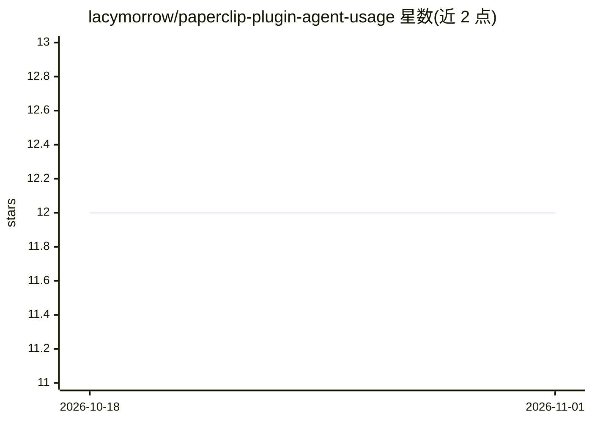

# lacymorrow/paperclip-plugin-agent-usage

⭐ 12 · TypeScript · MIT · 推送 2026-10-28 · [GitHub](https://github.com/lacymorrow/paperclip-plugin-agent-usage) · [官网](https://www.npmjs.com/package/paperclip-plugin-agent-usage) · 个人维护

**Paperclip 插件：追踪 Claude 用量配额，供 agent 自查余量**

Paperclip（AI agent 平台）的插件，通过 OAuth usage API 与 CLI 回退定时轮询 Claude（Anthropic）配额数据，提供仪表盘组件、用量详情页与重置时间展示。向 agent 暴露 get-usage / get-usage-summary 两个工具，使其在执行高消耗操作前可自查剩余额度并自行节流。OAuth 凭据从 ~/.claude 或 macOS Keychain 自动检测，令牌生命周期由 Paperclip 管理。安装经 Paperclip 插件管理器 UI 或 REST API；目前仅支持 Claude，其他 provider 在规划中。

## 筛选速览

| 维度 | 判定 | 备注 |
|---|---|---|
| AI 角色 | `ai-ecosystem` | LLM/agent 周边工具 |
| 许可风险 | `permissive` | MIT |
| 部署形态 | `library` | 以包/库形式分发 |
| 模型依赖 | locked-api |  |
| 硬件要求 | — | 无带数字的原话,不猜 |
| 安装摩擦 | `low` | 无编译、无系统依赖或容器化 |
| 成熟度 | — | 结构信号不足 |

## 能力要点

- 仪表盘组件与用量详情页，含按模型配额条与重置时间
- get-usage / get-usage-summary agent 工具，支持 agent 自节流
- 每 15 分钟可配置的定时轮询
- OAuth 凭据自动检测（~/.claude 或 macOS Keychain）

## 适用场景

- 在 agent 执行高消耗调用前查询剩余配额
- 在仪表盘中查看 Claude 会话/每周/按模型用量
- 追踪各配额窗口的重置时间

## 场景标签

`LLM 可观测性` · 领域:评测与运维

## 证据(README 行号)

> L17: A Paperclip plugin that tracks AI provider usage quotas and exposes real-time data to your agents and the dashboard
> L23: - **Agent tools** — `get-usage` and `get-usage-summary` so agents can self-throttle

## 星数曲线

2026-10-18 12 → 2026-11-01 12（+0）

---
*卡片 v1 · prompt 1.4 · 生成 2026-11-01 · 置信度 mid · 依据 README sha `76995fe06b60` · [字段定义](../../DATASET.md)*
