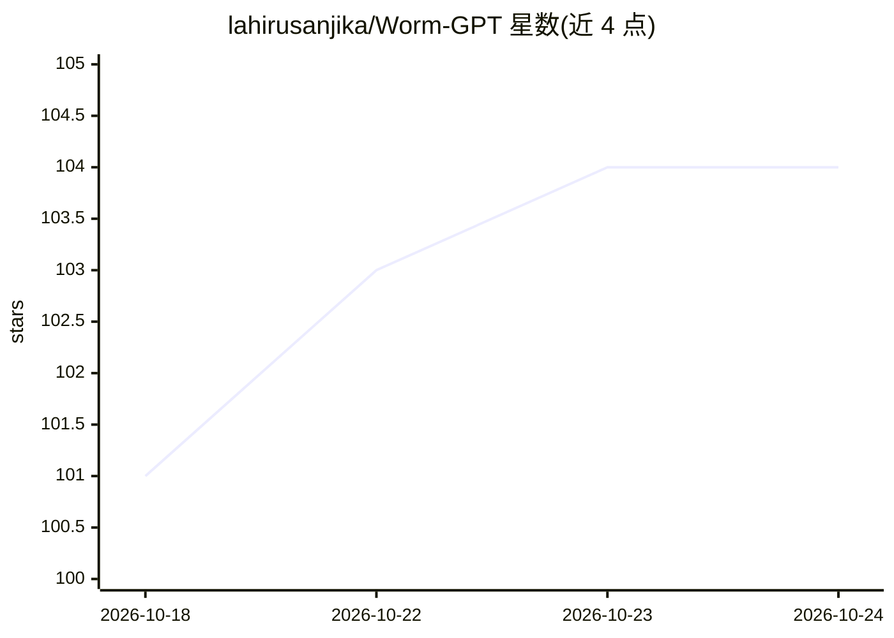

# lahirusanjika/Worm-GPT

⭐ 104 · JavaScript · MIT · 推送 2026-05-07 · [GitHub](https://github.com/lahirusanjika/Worm-GPT) · 个人维护

**基于 Groq API 的 Electron+React 桌面聊天客户端（Windows）**

面向终端用户的桌面 LLM 聊天客户端：用 Electron + React 构建，通过 Groq API 获取模型回答。提供多会话侧栏与持久历史、API key 管理（保存/测试/撤销）、本地聊天存储、渲染进程打包混淆，以及可选的 GPU 硬件加速禁用开关（用于排查黑屏或驱动问题）。安装需 Node.js 18+，Windows 10/11 可构建 NSIS 安装包与便携版 EXE，附 run-wormgpt.bat 启动器可自动构建并选择硬件加速模式。API key 以明文存储在 %APPDATA%\wormgpt\wormgpt-data.json。

## 筛选速览

| 维度 | 判定 | 备注 |
|---|---|---|
| AI 角色 | `ai-native` | 本体是模型或模型工具 |
| 许可风险 | `permissive` | MIT |
| 部署形态 | `library` | 以包/库形式分发 |
| 模型依赖 | locked-api |  |
| 硬件要求 | — | 无带数字的原话,不猜 |
| 安装摩擦 | `low` | 无编译、无系统依赖或容器化 |
| 成熟度 | — | 结构信号不足 |

## 能力要点

- 多会话侧栏与持久化本地聊天历史
- API key 管理：保存、测试与一键撤销
- 可选禁用 GPU 硬件加速以排查渲染问题
- npm run dist 构建 Windows 安装包与便携版 EXE

## 适用场景

- 在 Windows 桌面上通过自己的 Groq API key 聊天
- 管理多个会话并保留本地聊天记录
- 构建分发的安装包/便携版给他人使用

## 场景标签

`聊天机器人` · 领域:对话与助手

## 证据(README 行号)

> L3: WormGPT is a desktop chat client built with Electron + React and powered by the Groq API.
> L6: - Multi-chat sidebar with persistent history

## 星数曲线

2026-10-18 101 → 2026-10-24 104（+3）

---
*卡片 v1 · prompt 1.4 · 生成 2026-10-23 · 置信度 high · 依据 README sha `3ce9cdacc4e4` · [字段定义](../../DATASET.md)*
