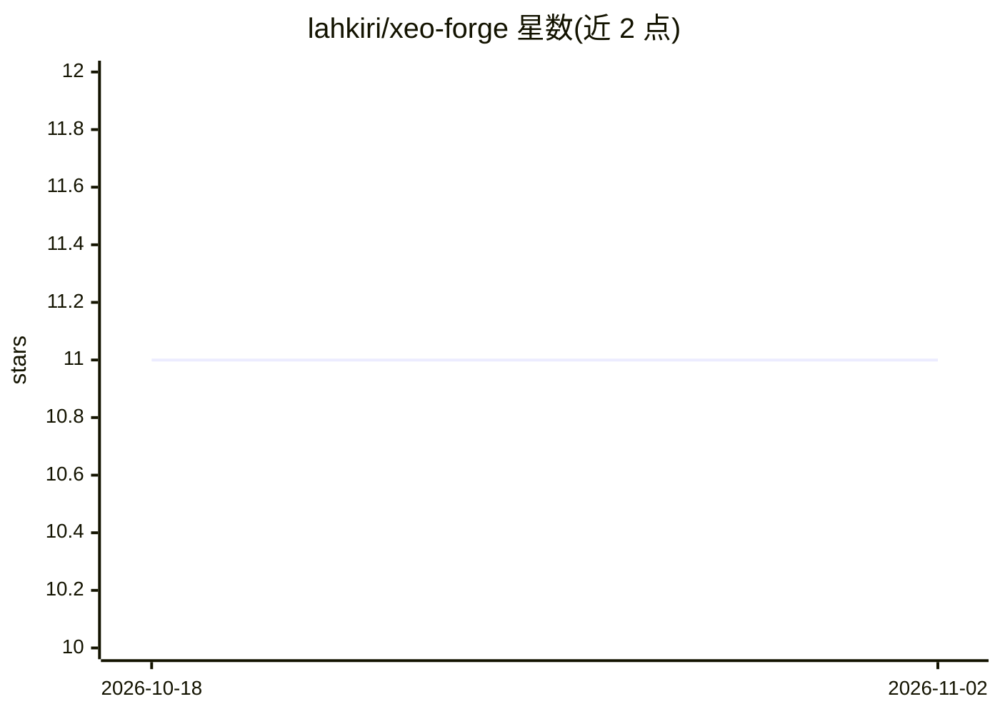

# lahkiri/xeo-forge

⭐ 11 · TypeScript · MIT · 推送 2026-09-02 · [GitHub](https://github.com/lahkiri/xeo-forge) · 个人维护

**本地自托管 AI agent 治理控制平面：审批式执行与可审计**

面向软件构建与知识工作 agent 的 local-first 控制平面（Next.js 14 / TypeScript），提供受治理的 Work 界面与普通 Chat 界面、持久化上下文、可复用 profiles 与 skills、工作区文件边界、事件历史、用户控制的浏览器与桌面运行时。机制上：计划审批前只读、批准后计划快照冻结、Diff 逐行审查、记忆提议须显式保留、沙箱分 standard/strict/docker 三档，代码执行为受限主机执行而非 OS 级隔离；README 明确列出多项已知缺口（如 per-task 权限覆盖未落地、子 agent 只读）。通过 git clone + npm 安装运行，支持 Docker 自托管。

## 筛选速览

| 维度 | 判定 | 备注 |
|---|---|---|
| AI 角色 | `ai-ecosystem` | LLM/agent 周边工具 |
| 许可风险 | `permissive` | MIT |
| 部署形态 | `self-host` | docker 或自建部署 |
| 模型依赖 | — | README 未给出锁定关系 |
| 硬件要求 | — | 无带数字的原话,不猜 |
| 安装摩擦 | `low` | 无编译、无系统依赖或容器化 |
| 成熟度 | `idea` | |

## 能力要点

- 审批优先执行：计划批准前无法写文件或执行代码
- 三档沙箱（standard/strict/docker），Docker 缺失时 fail closed
- 记忆为有界提议，仅显式保留后才进入上下文并记录审计事件
- 自托管 Docker 部署与可安装桌面运行时

## 适用场景

- 在本机项目上让单个 agent 受控执行计划-构建-验证流程
- 团队定义 agent 行为策略、审批门槛与审计留痕
- 审查 agent 每次运行的文件变更与终端活动

## 场景标签

`Agent 框架` `AI 助手` · 领域:Agent 开发

## 证据(README 行号)

> L16: Xeo Forge is a **local-first control plane for agentic work**. It gives software-building and knowledge-work agents
> L37: **Xeo Forge is not another terminal wrapper and not a cloud-only agent.** Claude Code, Codex, and OpenCode are powe
> L41: > **Your agents can execute. Xeo Forge gives execution a policy, a memory, an audit trail, and a proof of work.**

## 星数曲线

2026-10-18 11 → 2026-11-02 11（+0）

---
*卡片 v1 · prompt 1.4 · 生成 2026-11-02 · 置信度 mid · 依据 README sha `01c349e5ad3e` · [字段定义](../../DATASET.md)*
