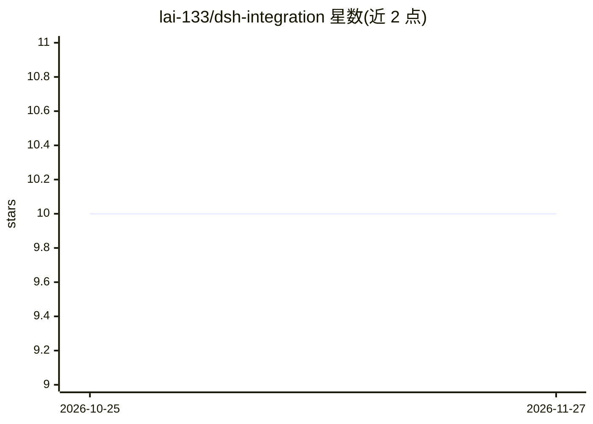

# lai-133/dsh-integration

⭐ 10 · JavaScript · MIT · 推送 2026-08-31 · [GitHub](https://github.com/lai-133/dsh-integration) · 个人维护 · 中文 README

**把 DeepSeek Harness 装进 Electron 桌面窗口并预集成五个插件**

dsh-desktop 以 Electron 壳包裹自托管的 dsh web 服务，网页端功能（会话/子代理/工作流/工具审批等）原样保留，预集成 dsh-better-sidebar、dsh-web-ui、ModLens、dshmarket、dsh-whale-widget 五个开源项目，并提供系统托盘、原生通知、外链外置、单实例锁等桌面能力。桌面端与网页端共享同一 DSH_HOME；npm run setup 自动完成 DSH 运行时安装、profile 初始化与插件挂载，安装过程走 npmmirror 国内镜像，不依赖 GitHub。需 Node.js ≥ 20；第三方插件以用户权限运行，README 提示自行审阅源码。

## 筛选速览

| 维度 | 判定 | 备注 |
|---|---|---|
| AI 角色 | `ai-ecosystem` | LLM/agent 周边工具 |
| 许可风险 | `permissive` | MIT |
| 部署形态 | `library` | 以包/库形式分发 |
| 模型依赖 | local-ok | 支持本地模型 |
| 硬件要求 | — | 无带数字的原话,不猜 |
| 安装摩擦 | `low` | 无编译、无系统依赖或容器化 |
| 成熟度 | — | 结构信号不足 |

## 能力要点

- Electron 壳 + 自托管 dsh web 服务，共享同一 DSH_HOME
- 预集成五个开源插件，npm run setup 自动完成初始化与挂载
- 内置 1054 插件 / 14 分类的插件精选画廊与可视化插件市场
- 安装不依赖 GitHub，依赖源内置 npmmirror 国内镜像

## 适用场景

- 在桌面窗口中使用 DeepSeek Harness 的完整 web 功能
- 通过插件市场一键安装/升级社区插件
- 国内无 GitHub 访问条件下离线分发与安装

## 场景标签

`AI 助手` · 领域:对话与助手

## 证据(README 行号)

> L12: 把 DeepSeek Harness（DSH）装进一个原生桌面窗口：**Electron 壳 + 自托管 `dsh web` 服务**。网页端全部功能原样保留，并预集成五个开源项目，附带系统托盘、原生通知、插件精选画廊等桌面能力。
> L25: ## 🧩 集成的开源项目
> L33: |dshmarket|DSH 可视化插件市场：设置页内浏览、搜索、**一键安装/升级/卸载**社区插件（取代 dsh-web-ui 内置的「社区插件」静态索引，后者已禁用）|dsh-market · MIT|

## 星数曲线

2026-10-25 10 → 2026-11-27 10（+0）

---
*卡片 v1 · prompt 1.4 · 生成 2026-11-19 · 置信度 high · 依据 README sha `e09f38f124f5` · [字段定义](../../DATASET.md)*
