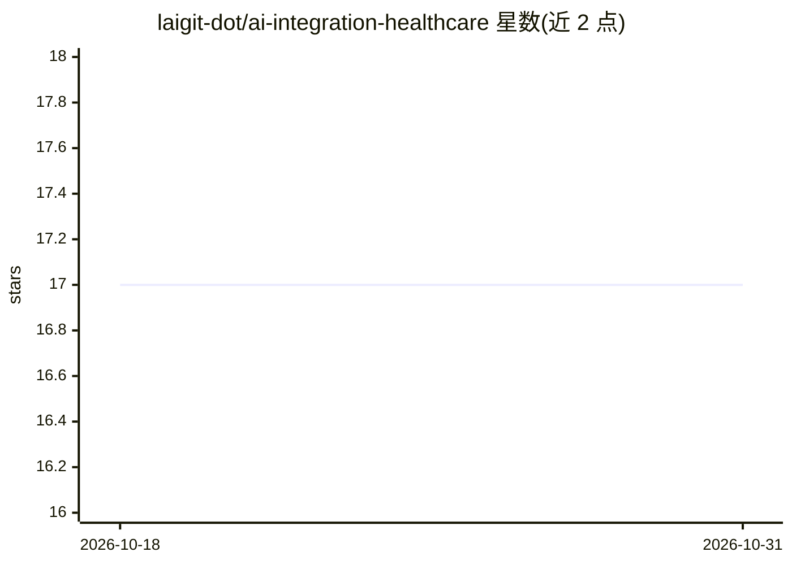

# laigit-dot/ai-integration-healthcare

⭐ 17 · Jupyter Notebook · Apache-2.0 · 推送 2026-03-23 · [GitHub](https://github.com/laigit-dot/ai-integration-healthcare) · 个人维护

**医疗健康领域 AI/ML 项目集合：分类、检测与影像分割**

个人维护的医疗健康 AI 项目集，按训练营、AI 教育、研究项目三部分组织，共约 17 个项目，逐条标注完成状态（✅/🚧/❌）。内容涵盖乳腺癌分类、COVID-19 胸片检测、糖尿病预测、心脏病分类、阿尔茨海默病分级预测、胶质瘤与多发性硬化病灶分割、NLP 区分认知阅读状态等，使用 PyTorch、Keras/TensorFlow、PySpark MLlib、CNN 与 Transformer 等技术，数据多取自 Kaggle、UCI、ZuCo 等公开来源。README 仅列项目目录，未提供统一安装或运行说明。

## 筛选速览

| 维度 | 判定 | 备注 |
|---|---|---|
| AI 角色 | `ai-knowledge` | 知识聚合/清单类 |
| 许可风险 | `permissive` | Apache-2.0 |
| 部署形态 | `None` |  |
| 模型依赖 | — | README 未给出锁定关系 |
| 硬件要求 | — | 无带数字的原话,不猜 |
| 安装摩擦 | `low` | 无编译、无系统依赖或容器化 |
| 成熟度 | — | 结构信号不足 |

## 能力要点

- 约 17 个医疗 AI 项目，涵盖分类/检测/分割/NLP 任务
- 逐项目标注完成状态（✅ 完成 / 🚧 进行中）
- 技术栈覆盖 PyTorch、Keras/TensorFlow、PySpark MLlib、CNN、Transformer

## 适用场景

- 查找医疗影像分类与分割的入门/学习项目
- 参考乳腺癌、COVID-19、阿尔茨海默病等数据的建模流程
- 了解同一作者在医疗 AI 方向的项目进展

## 场景标签

`教程课程` · 领域:学习与行业

## 证据(README 行号)

> L3: This repository is included artificial intelligence, machine learning, data science, computer vision projects relate
> L11: - **Breast Cancer Classification ✅:** The aim of this project is classification the tumors into malignant or benign
> L32: - **Chest X-Ray Image Classification by using PyTorch, CNN (Pneumonia)✅:** This project involves building a convolu

## 星数曲线

2026-10-18 17 → 2026-10-31 17（+0）

---
*卡片 v1 · prompt 1.4 · 生成 2026-10-29 · 置信度 high · 依据 README sha `546003cec8be` · [字段定义](../../DATASET.md)*
