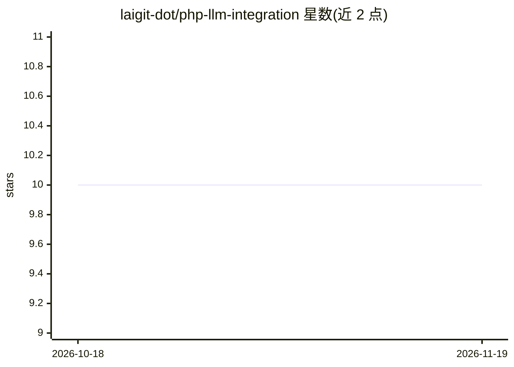

# laigit-dot/php-llm-integration

⭐ 10 · PHP · MIT · 推送 2026-09-10 · [GitHub](https://github.com/laigit-dot/php-llm-integration) · 个人维护

**PHP 开发者的 Ollama 客户端库：调用本地 LLM API**

面向 PHP 8.1+ 的 Ollama 客户端库，经 Composer 安装（包名 ardagnsrn/ollama-php），通过客户端实例访问 Ollama 服务端（默认 localhost:11434，可自定义地址）。资源覆盖 Completions/Chat（含流式与 tools 函数调用参数）、Embed 嵌入生成、Models 的增删改查/复制/pull/push/运行列表，以及 Blobs 检查与创建。需本地运行 Ollama 作为服务端，chat 流式方法不支持 tools 参数。

## 筛选速览

| 维度 | 判定 | 备注 |
|---|---|---|
| AI 角色 | `ai-ecosystem` | LLM/agent 周边工具 |
| 许可风险 | `permissive` | MIT |
| 部署形态 | `None` |  |
| 模型依赖 | local-ok | 支持本地模型 |
| 硬件要求 | — | 无带数字的原话,不猜 |
| 安装摩擦 | `low` | 无编译、无系统依赖或容器化 |
| 成熟度 | — | 结构信号不足 |

## 能力要点

- Chat/Completions 支持 create 与 createStreamed 两种调用方式
- Chat 的 tools 参数支持自定义函数调用（与流式不兼容）
- Models 资源覆盖 list/show/create/copy/delete/pull/push/runningList
- Embed 嵌入生成与 Blobs 检查/创建

## 适用场景

- 在 PHP 项目中调用本地 Ollama 模型生成文本与对话
- 为 Laravel/PHP 应用接入本地 LLM 的嵌入向量能力
- 通过代码管理 Ollama 模型的拉取、推送与删除

## 场景标签

 · 领域:LLM 基础设施/客户端 SDK

## 证据(README 行号)

> L2: This is a PHP library for Ollama. Ollama is an open-source project that serves as a powerful and user-friendly platf
> L16: > **Requires Ollama**
> L20: First, install Ollama PHP via the Composer package manager:

## 星数曲线

2026-10-18 10 → 2026-11-19 10（+0）

---
*卡片 v1 · prompt 1.4 · 生成 2026-11-19 · 置信度 high · 依据 README sha `f6a6d4567dc3` · [字段定义](../../DATASET.md)*
