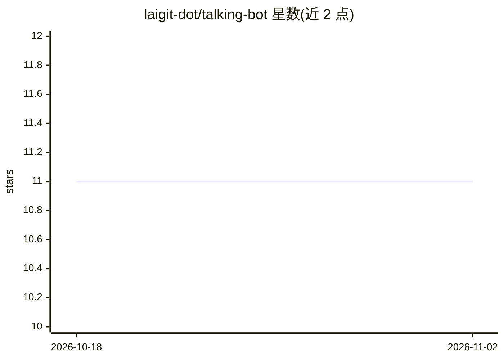

# laigit-dot/talking-bot

⭐ 11 · PHP · 推送 2026-05-25 · [GitHub](https://github.com/laigit-dot/talking-bot) · 个人维护

**PHP/Python 实现的类 ChatGPT 聊天机器人，接入 OpenAI API**

名为 ChatWTF 的网页聊天机器人：PHP 提供前端与后端服务，调用 OpenAI API 生成回答，对话默认存于 PHP 会话，可选切换 SQLite/MySQL 存储。包含 CodeInterpreter 模式，可直接在本机运行 Python 代码（需确认），或通过 Docker 沙箱容器隔离执行。提供 Docker 构建与运行方式，需在 settings.php 中配置 OpenAI API key。作者为其 YouTube 频道创建此项目。

## 筛选速览

| 维度 | 判定 | 备注 |
|---|---|---|
| AI 角色 | `ai-native` | 本体是模型或模型工具 |
| 许可风险 | `none` | — |
| 部署形态 | `self-host` | docker 或自建部署 |
| 模型依赖 | — | README 未给出锁定关系 |
| 硬件要求 | — | 无带数字的原话,不猜 |
| 安装摩擦 | `low` | 无编译、无系统依赖或容器化 |
| 成熟度 | — | 结构信号不足 |

## 能力要点

- 调用 OpenAI API 的网页聊天界面
- CodeInterpreter 模式可运行 Python 代码，支持 Docker 沙箱隔离
- 会话存储默认 PHP session，可切换 SQLite/MySQL
- 提供 Docker 构建与运行命令

## 适用场景

- 自建一个可定制的类 ChatGPT 网页聊天机器人
- 让聊天机器人代为执行 Python 代码并查看结果
- 通过修改系统消息定制机器人行为

## 场景标签

`聊天机器人` · 领域:对话与助手

## 证据(README 行号)

> L3: This is a ChatGPT-like chatbot that uses the ChatGPT API. It was created for my YouTube channel. You can find the pl
> L8: 2. Add your OpenAI API key to `settings.php` (see `settings.sample.php`)

## 星数曲线

2026-10-18 11 → 2026-11-02 11（+0）

---
*卡片 v1 · prompt 1.4 · 生成 2026-11-02 · 置信度 high · 依据 README sha `fb68c416d625` · [字段定义](../../DATASET.md)*
