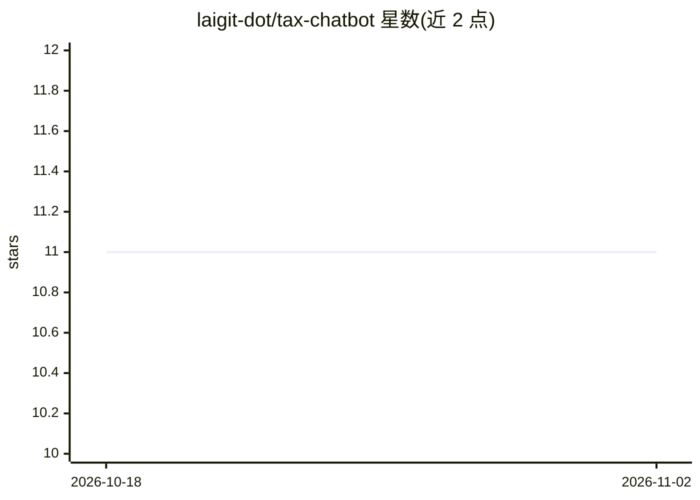

# laigit-dot/tax-chatbot

⭐ 11 · Python · 推送 2026-05-23 · [GitHub](https://github.com/laigit-dot/tax-chatbot) · 个人维护

**财税问答混合 RAG 聊天机器人：向量/图谱/结构化三路检索**

基于 Django + DRF 的税务与财务问答 chatbot，通过 GPT-4o-mini 路由器对查询分类并抽取实体（纳税人类型、州、年份等），激活三条检索通道：FAISS 向量检索处理非结构化文档（IRS 1040 指南、美国税法 Title 26、PPT）、NetworkX 知识图谱处理实体比较与排名、pandas 处理 CSV 精确数值聚合。数据含 5,000 行税务 CSV 等，自带 .ppt 二进制格式解析器。运行依赖 Python 3.12+ 与 OpenAI API key，向量库测试需有效 key。项目为技术评估作品，声明不授权商业使用。

## 筛选速览

| 维度 | 判定 | 备注 |
|---|---|---|
| AI 角色 | `ai-native` | 本体是模型或模型工具 |
| 许可风险 | `none` | — |
| 部署形态 | `library` | 以包/库形式分发 |
| 模型依赖 | — | README 未给出锁定关系 |
| 硬件要求 | — | 无带数字的原话,不猜 |
| 安装摩擦 | `low` | 无编译、无系统依赖或容器化 |
| 成熟度 | — | 结构信号不足 |

## 能力要点

- 三通道检索：FAISS 向量、NetworkX 图谱、pandas 结构化查询，由 GPT-4o-mini 路由
- 按数据源定制的分块策略（CSV 转自然语言句、PDF 重叠分块、PPT 按页）
- 自研 OLE 复合文档解析器读取旧版 .ppt，零额外依赖
- 60 个测试用例；完整部署与测试成本声明低于 $0.50

## 适用场景

- 查询美国联邦税法与报税指南等法规文档
- 比较各州、各纳税人类型的税率与税负数据
- 对税务 CSV 数据做精确数值统计问答

## 场景标签

`聊天机器人` `RAG` · 领域:对话与助手

## 证据(README 行号)

> L3: A hybrid RAG chatbot that answers financial and tax questions using structured data, regulatory documents, and AI-po
> L45: The router uses GPT-4o-mini with few-shot examples to classify queries and extract entities (taxpayer type, state, 

## 星数曲线

2026-10-18 11 → 2026-11-02 11（+0）

---
*卡片 v1 · prompt 1.4 · 生成 2026-11-02 · 置信度 mid · 依据 README sha `c29cebfcd05f` · [字段定义](../../DATASET.md)*
