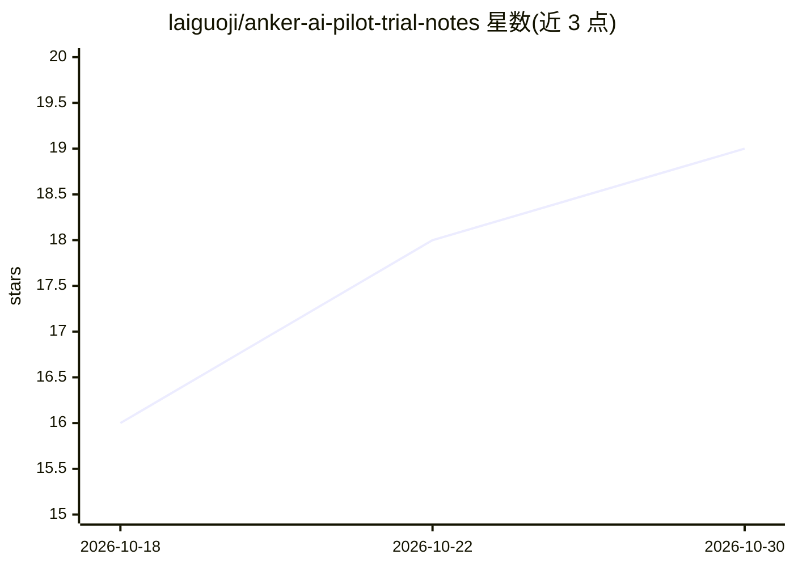

# laiguoji/anker-ai-pilot-trial-notes

⭐ 19 · 推送 2026-06-27 · [GitHub](https://github.com/laiguoji/anker-ai-pilot-trial-notes) · 个人维护 · 中文 README

**安克创新 AI 飞行员试炼面经：AI 协作测评复盘与对话模板**

一篇通过测评的算法工程师撰写的公开复盘文档：介绍安克创新'AI 飞行员试炼'测评形式（90-120 分钟、给定业务背景借助 AI 完成方案），归纳结构化表达、任务拆解、批判性判断、方案收敛四类考察能力，并提供一套 16 轮通用对话模板、推荐对话节奏与脱敏案例思考框架。面向准备该测评或 AI 协作类面试的求职者，纯文档内容，无可安装组件。

## 筛选速览

| 维度 | 判定 | 备注 |
|---|---|---|
| AI 角色 | `ai-knowledge` | 知识聚合/清单类 |
| 许可风险 | `none` | — |
| 部署形态 | `None` |  |
| 模型依赖 | — | README 未给出锁定关系 |
| 硬件要求 | — | 无带数字的原话,不猜 |
| 安装摩擦 | `low` | 无编译、无系统依赖或容器化 |
| 成熟度 | — | 结构信号不足 |

## 能力要点

- 四类考察能力归纳（结构化表达/任务拆解/批判性判断/方案收敛）
- 16 轮通用对话模板，标注每轮体现的能力
- 脱敏案例的业务-技术-验收思考框架

## 适用场景

- 准备安克创新 AI 飞行员试炼或 AI 协作类测评
- 练习多轮 Prompt 对话与批判性追问
- 学习把 AI 作为协作对象管理的方案收敛流程

## 场景标签

`提示工程` `教程课程` · 领域:Agent 开发

## 证据(README 行号)

> L1: # 安克创新 AI 飞行员试炼面经：AI 协作能力测评复盘
> L15: 安克创新的 “AI 飞行员试炼” 是一类偏 AI 协作能力的测评。整体时间大约在 90-120 分钟，候选人需要在指定环境中，根据给定的业务背景、角色设定和交付要求，借助 AI 完成一份解决方案。

## 星数曲线

2026-10-18 16 → 2026-10-30 19（+3）

---
*卡片 v1 · prompt 1.4 · 生成 2026-10-29 · 置信度 high · 依据 README sha `672f42f2d8a5` · [字段定义](../../DATASET.md)*
