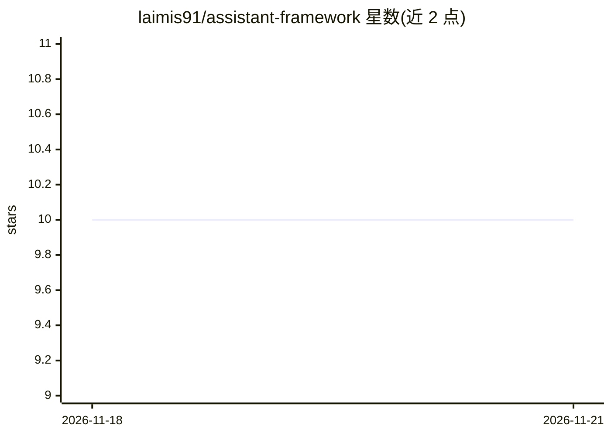

# laimis91/assistant-framework

⭐ 10 · Shell · MIT · 推送 2026-11-18 · [GitHub](https://github.com/laimis91/assistant-framework) · 个人维护

**为开发者的 AI 编码助手提供的 16 项结构化技能插件市场**

一个面向 Claude Code 与 Codex 的插件市场仓库，打包单个 assistant-framework 插件，内含 16 个 assistant-* 技能：结构化工作流、需求澄清、条件式 TDD、调试、结构化思考、来源核查研究、STRIDE/OWASP 安全分析、文档生成、代码库入门、评审自动化、技能创建、验证选择、可行性实验与探索式 UI QA。安装通过 claude/codex 的 plugin marketplace 命令完成；手动安装脚本已于 2026-11-17 停用，市场为唯一支持渠道；可选子代理定义与指令块需手动放置。

## 筛选速览

| 维度 | 判定 | 备注 |
|---|---|---|
| AI 角色 | `ai-ecosystem` | LLM/agent 周边工具 |
| 许可风险 | `permissive` | MIT |
| 部署形态 | `None` |  |
| 模型依赖 | — | README 未给出锁定关系 |
| 硬件要求 | — | 无带数字的原话,不猜 |
| 安装摩擦 | `low` | 无编译、无系统依赖或容器化 |
| 成熟度 | — | 结构信号不足 |

## 能力要点

- 16 个 assistant-* 技能，覆盖工作流、调试、评审、安全分析与文档生成
- 以 Claude Code 与 Codex 插件市场形式分发，支持 CLI 与桌面端安装
- 评审采用证据门控：新一轮修复需新证据，无轮次上限
- 三个技能可上传至 Claude 网页/桌面/移动端聊天使用

## 适用场景

- 在 Claude Code 或 Codex 中为编码助手添加结构化开发流程
- 为 AI 辅助开发引入统一的调试、评审与验证规范
- 通过探索式 UI QA 技能对运行中的界面进行可用性检查

## 场景标签

`编码 Agent` · 领域:编码与开发

## 证据(README 行号)

> L3: A Personal AI Assistant framework for developers. 16 first-class `assistant-*` skills: structured workflow, clarific
> L28: This repository is a plugin marketplace for Claude Code and Codex. It ships one plugin, `assistant-framework`, with

## 星数曲线

2026-11-18 10 → 2026-11-21 10（+0）

---
*卡片 v1 · prompt 1.4 · 生成 2026-11-19 · 置信度 high · 依据 README sha `eb01a069291e` · [字段定义](../../DATASET.md)*
