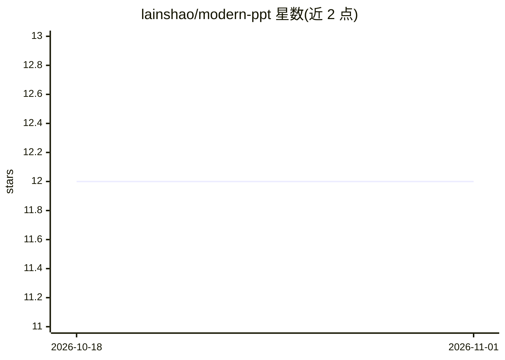

# lainshao/modern-ppt

⭐ 12 · HTML · AGPL-3.0 · 推送 2026-07-09 · [GitHub](https://github.com/lainshao/modern-ppt) · [官网](https://lainshao.github.io/modern-ppt/) · 个人维护 · 中文 README

**供 coding agent 使用的单文件 HTML 演示文稿生成技能**

一个 Agent Skill（SKILL.md 排版规范 + HTML 模板 + 动效引擎），供支持 Agent Skills 的 coding agent（Claude Code、Codex CLI、Gemini CLI、Cursor、Copilot CLI、OpenCode 等）按一句话/大纲/文档生成单文件 HTML 演示文稿。内置 12 个版式、3 套可放映中切换的配色、Chart.js 图表、count-up 数字与键盘/滚轮/触摸翻页；产出为单个 HTML 文件，浏览器打开即放映，无需构建步骤。无 agent 时也可直接打开模板预览。衍生自 guizang-ppt-skill，采用 AGPL-3.0。

## 筛选速览

| 维度 | 判定 | 备注 |
|---|---|---|
| AI 角色 | `ai-ecosystem` | LLM/agent 周边工具 |
| 许可风险 | `viral` | AGPL-3.0 |
| 部署形态 | `None` |  |
| 模型依赖 | locked-api |  |
| 硬件要求 | — | 无带数字的原话,不猜 |
| 安装摩擦 | `low` | 无编译、无系统依赖或容器化 |
| 成熟度 | — | 结构信号不足 |

## 能力要点

- 12 个版式 + 3 套放映时可一键切换的配色
- 产出为单文件 HTML，浏览器打开即放映，无构建步骤
- 内置排版硬规范，约束 AI 生成一致的视觉系统
- 兼容多种支持 Agent Skills 的 coding agent

## 适用场景

- 让 Claude Code 等 agent 把大纲或文档做成投屏网页 PPT
- 不用演示软件，直接在浏览器放映单文件 deck
- 按统一排版规范批量产出风格一致的演示文稿

## 场景标签

 · 领域:演示文稿/Agent 技能

## 证据(README 行号)

> L5: > **Modern PPT is an open-source Agent Skill for generating polished, single-file HTML presentations from a prompt, 
> L61: - **是一个 skill**（菜谱+模板），不是一份做好的 PPT。装上后说「按 modern-ppt 做个 X 主题的分享 deck」，它按这套风格+规范帮你生成。
> L66: 需要一个**支持 Agent Skills 的 coding agent** —— Claude Code / Codex CLI / Gemini CLI / Cursor / Copilot CLI / OpenCode 等都

## 星数曲线

2026-10-18 12 → 2026-11-01 12（+0）

---
*卡片 v1 · prompt 1.4 · 生成 2026-11-01 · 置信度 high · 依据 README sha `a06776560f3c` · [字段定义](../../DATASET.md)*
