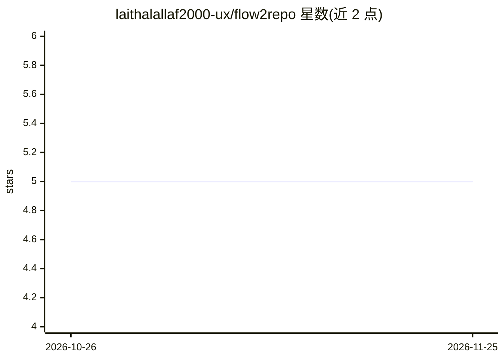

# laithalallaf2000-ux/flow2repo

⭐ 5 · HTML · MIT · 推送 2026-10-22 · [GitHub](https://github.com/laithalallaf2000-ux/flow2repo) · [官网](https://flow2repo.laithalallaf.com/) · 个人维护

**帮设计者把 AI 生成的 HTML 设计转成可运行 React 项目**

浏览器端运行的转换工具：读取由 ChatGPT/Claude/Gemini 等生成的 HTML 设计（配合官方固定 prompt 标记屏幕、共享组件与交互），输出结构化的 React 19 + TypeScript 工程，包含路由、复用组件、typed 数据层、表单状态与 Tailwind 配置。转换本身为确定性代码，不调用 AI，同一设计产出结果一致，无法转换的内容列入报告；所有处理在浏览器本地完成，设计文件不上传。需 Node 20+ 从源码运行。

## 筛选速览

| 维度 | 判定 | 备注 |
|---|---|---|
| AI 角色 | `ai-ecosystem` | LLM/agent 周边工具 |
| 许可风险 | `permissive` | MIT |
| 部署形态 | `library` | 以包/库形式分发 |
| 模型依赖 | — | README 未给出锁定关系 |
| 硬件要求 | — | 无带数字的原话,不猜 |
| 安装摩擦 | `low` | 无编译、无系统依赖或容器化 |
| 成熟度 | — | 结构信号不足 |

## 能力要点

- 确定性转换：无 AI 参与的转换时流程，附带转换报告
- 重复元素抽取为 typed 数组 + .map()，共享组件提取为 props 组件
- 交互标记（data-toggle/data-tab）转为 React useState
- 全程浏览器内运行，设计文件不离开本机

## 适用场景

- 把用 AI 设计的 dashboard 原型直接变成可开发的 React 仓库
- 给生成的静态设计补上路由、组件与表单状态
- 把设计中的示例数据整理成独立数据文件，便于接入后端

## 场景标签

`代码生成` · 领域:编码与开发

## 证据(README 行号)

> L26: AI can design a whole app in minutes. Turning that HTML into a real project still takes hours: splitting pages, wir
> L30: - **Plain code, no AI at conversion time.** The same design always produces the same project, and anything that can
> L45: One more thing matters to me: not everything has to be AI. AI helped me build this converter, but the converter its

## 星数曲线

2026-10-26 5 → 2026-11-25 5（+0）

---
*卡片 v1 · prompt 1.4 · 生成 2026-11-21 · 置信度 mid · 依据 README sha `3d81d35ad632` · [字段定义](../../DATASET.md)*
