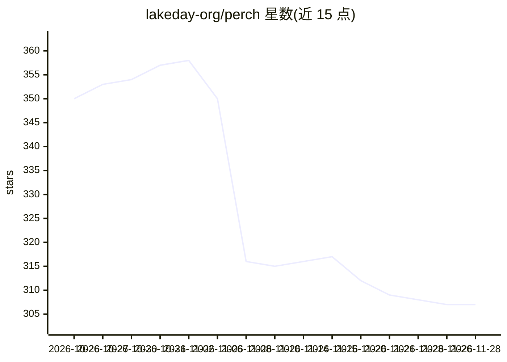

# lakeday-org/perch

⭐ 307 · JavaScript · MIT · 推送 2026-11-16 · [GitHub](https://github.com/lakeday-org/perch) · [官网](https://perchscan.com) · 组织维护

**面向开发者的语义代码与安全扫描 CLI**

以 npm 全局包形式分发的命令行扫描器，对代码库运行 `perch scan` 输出问题列表（ID/行号/严重度/置信度），提供 `perch issues` 与 `perch check` 查看与复核。语义判断由云端模型完成：默认由 Perch Cloud 路由，可按环境变量切换到多种决策模型端点；首个 $5 免费且结果缓存后重复扫描不收费。支持在 perch.yaml 中编写自定义语义 lint 规则，并可为 Claude Code/Codex/Cursor 等助手安装技能文件，云侧可在 CI 中扫描 PR。

## 筛选速览

| 维度 | 判定 | 备注 |
|---|---|---|
| AI 角色 | `ai-native` | 本体是模型或模型工具 |
| 许可风险 | `permissive` | MIT |
| 部署形态 | `library` | 以包/库形式分发 |
| 模型依赖 | — | README 未给出锁定关系 |
| 硬件要求 | — | 无带数字的原话,不猜 |
| 安装摩擦 | `low` | 无编译、无系统依赖或容器化 |
| 成熟度 | — | 结构信号不足 |

## 能力要点

- CLI 命令：scan/issues/check 与结果缓存去重计费
- perch.yaml 自定义语义 lint 规则（where/each/ensure）
- perch setup 为 Claude Code、Codex、Cursor 等安装技能/规则文件
- 可配置模型端点：System One 格式或 OpenAI Decisions API

## 适用场景

- 在提交前扫描代码中的语义与安全问题
- 把扫描集成进 CI 复核 pull request
- 为编码助手安装 perch 扫描技能
- 编写团队专属的语义 lint 规则

## 场景标签

`代码审查` · 领域:编码与开发

## 证据(README 行号)

> L18: Semantic code and security scanner.
> L102: By default, Perch Cloud routes your questions to the best model for answering them. To ask a specific decision mod
> L119: Any endpoint that supports the System One format will work, and so does OpenAI's Decisions API: perch recognizes a

## 星数曲线

2026-10-26 350 → 2026-11-28 307（-43）

---
*卡片 v1 · prompt 1.4 · 生成 2026-11-25 · 置信度 high · 依据 README sha `ee704a5a5764` · [字段定义](../../DATASET.md)*
