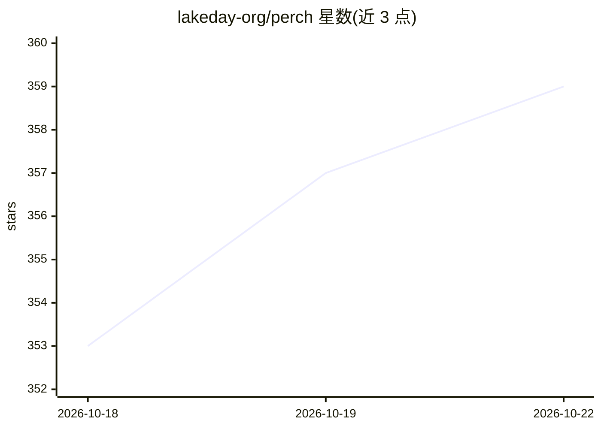

# lakeday-org/perch

⭐ 359 · JavaScript · MIT · 推送 2026-10-20 · [GitHub](https://github.com/lakeday-org/perch) · [官网](https://perchscan.com) · 组织维护

**基于决策模型的语义代码检查 CLI，供开发者扫描代码问题**

npm 安装的命令行语义代码检查工具：运行 perch scan 分析代码库，输出带严重度、置信度的问题清单，支持按 yaml 自定义 lint 规则（where/each/ensure 语法）。判断由云端决策模型（Jev、OpenAI Decisions 等）完成，决策结果缓存使重复扫描免费；可通过环境变量覆盖 endpoint 与模型，接入任何 System One 格式或 OpenAI Decisions API。需 perch login 登录 Perch Cloud（首 5 美元免费），云端也支持 CI 中扫描 PR。另提供 Claude Code/Codex/Cursor 等 agent 的技能配置命令。

## 筛选速览

| 维度 | 判定 | 备注 |
|---|---|---|
| AI 角色 | `ai-native` | 本体是模型或模型工具 |
| 许可风险 | `permissive` | MIT |
| 部署形态 | `library` | 以包/库形式分发 |
| 模型依赖 | — | README 未给出锁定关系 |
| 硬件要求 | — | 无带数字的原话,不猜 |
| 安装摩擦 | `low` | 无编译、无系统依赖或容器化 |
| 成熟度 | — | 结构信号不足 |

## 能力要点

- perch scan 输出带严重度/置信度的问题清单，结果缓存后重扫免费
- perch.yaml 自定义语义 lint 规则（where/each/ensure）
- 可切换多种决策模型后端（Jev、OpenAI Decisions、Liquid AI d1 等）
- perch setup 为 Claude Code/Codex/pi/Cursor 安装 agent 技能配置

## 适用场景

- 在代码库中扫描语义级问题并按优先级处理
- 在 CI 中对 PR 做代码检查门禁
- 为 AI 编程助手配置 perch 使用说明

## 场景标签

`代码审查` · 领域:编码与开发

## 证据(README 行号)

> L18: Semantic code linting with decision models.
> L92: By default, Perch Cloud routes your questions to the best model for answering them. To ask a specific decision mode

## 星数曲线

2026-10-18 353 → 2026-10-22 359（+6）

---
*卡片 v1 · prompt 1.4 · 生成 2026-10-21 · 置信度 high · 依据 README sha `3be7dc28ce47` · [字段定义](../../DATASET.md)*
