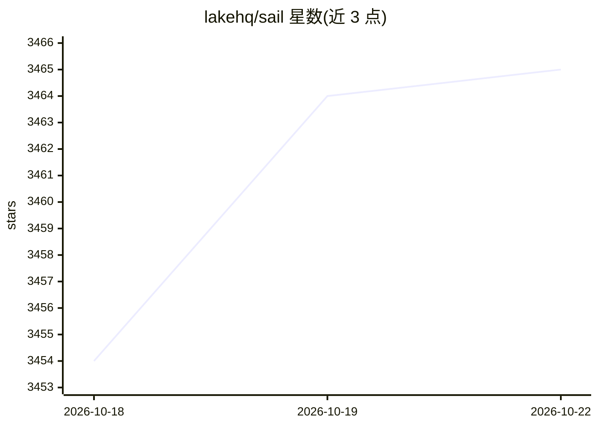

# lakehq/sail

⭐ 3,465 · Rust · Apache-2.0 · 推送 2026-10-21 · [GitHub](https://github.com/lakehq/sail) · [官网](https://lakesail.com) · 组织维护

**Rust 编写的 Apache Spark 替代引擎，统一批处理/流处理/AI 负载**

面向已有 Spark 用户的分布式计算引擎，以 Rust 实现并通过 Spark Connect 协议提供 Spark SQL 与 DataFrame API 兼容，PySpark 代码无需改写即可连接。构建于 Apache Arrow 与 DataFusion 之上，支持 Python UDF（零拷贝）、Delta Lake 与 Iceberg 表格式，以及多种目录与存储后端。安装方式为 PyPI 的 pysail 包或从源码构建，可本地单机运行，也可通过 Docker 镜像部署到 Kubernetes 集群。附带实验性 PySpark 函数兼容性检查脚本，README 标注该脚本不验证行为一致性。

## 筛选速览

| 维度 | 判定 | 备注 |
|---|---|---|
| AI 角色 | `ai-enhanced` | 去掉 AI 部分产品仍成立 |
| 许可风险 | `permissive` | Apache-2.0 |
| 部署形态 | `library` | 以包/库形式分发 |
| 模型依赖 | — | README 未给出锁定关系 |
| 硬件要求 | — | 无带数字的原话,不猜 |
| 安装摩擦 | `low` | 无编译、无系统依赖或容器化 |
| 成熟度 | `idea` | |

## 能力要点

- Spark Connect 协议兼容，PySpark 代码无需改写即可连接
- 基于 Apache Arrow 与 DataFusion 的列式向量化执行引擎
- 原生支持 Delta Lake / Iceberg 表格式及多种目录与存储后端
- 支持本地 CLI、Python API 与 Kubernetes 集群三种启动方式

## 适用场景

- 把现有 PySpark 批处理/ETL 负载迁移到 Rust 引擎运行
- 在同一引擎上运行批处理、流处理与 AI 计算负载
- 在 Kubernetes 集群中以分布式模式部署查询服务

## 场景标签

 · 领域:数据工程/分布式计算

## 证据(README 行号)

> L8: Sail is a **drop-in Apache Spark replacement** written in Rust, unifying batch processing, stream processing, and co
> L118: For over 15 years, Spark has been the default engine for distributed data processing, powering ETL, machine learni
> L120: But the JVM foundation that made Spark possible is now what holds it back. Sail is built to be a familiar, perform

## 星数曲线

2026-10-18 3,454 → 2026-10-22 3,465（+11）

---
*卡片 v1 · prompt 1.4 · 生成 2026-10-20 · 置信度 high · 依据 README sha `686258f95094` · [字段定义](../../DATASET.md)*
