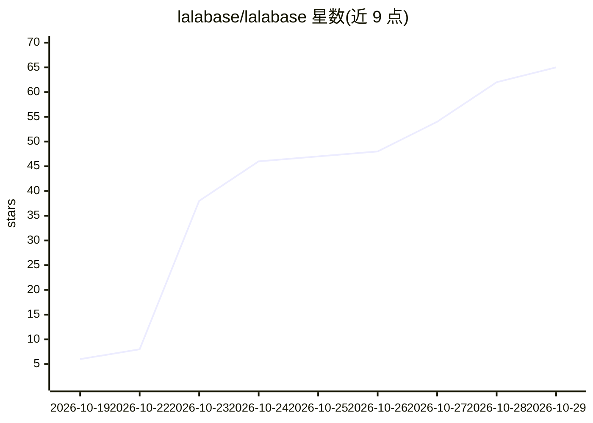

# lalabase/lalabase

⭐ 65 · Ruby · AGPL-3.0 · 推送 2026-10-28 · [GitHub](https://github.com/lalabase/lalabase) · [官网](https://lalabase.com) · 组织维护

**自托管的项目管理系统：工单/计时/文档/会议，AI 助手带出处引用**

面向软件代理商、自由职业者与小软件公司的自托管项目管理工具：客户与项目管理、自定义工单看板/列表、按工单计费的多段时间记录、项目文档（可挂接 GitHub/GitLab 仓库目录）、带转录与 AI 摘要的会议记录。AI 助手可跨工单、文档、计时与会议回答问题并引用来源；提供商可选 OpenAI、Anthropic、Vertex AI、Mistral 等，且默认关闭。基于 Rails 8.1 与 PostgreSQL(pgvector)，通过 Docker Compose 自托管，亦提供德国托管的云服务。提供 MCP server 与 REST API 供 Claude、Cursor 等 agent 接入。AGPL-3.0-only 许可。

## 筛选速览

| 维度 | 判定 | 备注 |
|---|---|---|
| AI 角色 | `ai-enhanced` | 去掉 AI 部分产品仍成立 |
| 许可风险 | `viral` | AGPL-3.0 |
| 部署形态 | `self-host` | docker 或自建部署 |
| 模型依赖 | — | README 未给出锁定关系 |
| 硬件要求 | — | 无带数字的原话,不猜 |
| 安装摩擦 | `low` | 无编译、无系统依赖或容器化 |
| 成熟度 | — | 结构信号不足 |

## 能力要点

- AI 助手回答项目数据问题并引用来源，支持多种 LLM 提供商（含自托管端点）
- 会议转录、AI 摘要与后续任务生成
- MCP server 与 REST API 可接入 Claude/Cursor 等 agent 操作工单与知识库
- Docker Compose 一键自托管（含 PostgreSQL/pgvector、Valkey、Caddy）

## 适用场景

- 软件团队把工单、文档、计时和会议记录集中在一个自托管系统里
- 让 AI 助手基于自己项目数据回答问题并核验出处
- 客户通过独立访问查看各自项目进展

## 场景标签

`知识库管理` `文档问答` · 领域:知识与检索

## 证据(README 行号)

> L53: - **AI assistant.** One question across tickets, docs, time and meetings, or about the one ticket
> L13: Tickets, time tracking, docs and meetings for software agencies and their clients, with an AI

## 星数曲线

2026-10-19 6 → 2026-10-29 65（+59）

---
*卡片 v1 · prompt 1.4 · 生成 2026-10-25 · 置信度 high · 依据 README sha `87bb72610b1c` · [字段定义](../../DATASET.md)*
