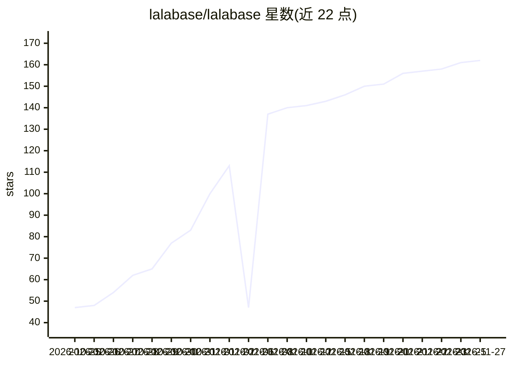

# lalabase/lalabase

⭐ 162 · Ruby · AGPL-3.0 · 推送 2026-11-26 · [GitHub](https://github.com/lalabase/lalabase) · [官网](https://lalabase.com) · 组织维护

**自托管客户项目协作空间，AI 助手回答带出处**

面向软件机构、自由职业者和小型软件公司的自托管项目管理平台，覆盖客户与项目组织、任务看板、工时记账、文档（可对接 GitHub/GitLab 目录）、会议转录与摘要。AI 助手基于自身项目数据回答问题并引用票据、会议等来源，默认关闭，由管理员选择模型提供方。提供 MCP server 与 REST API、macOS/Linux 终端 CLI。通过 Docker Compose 自托管，另有德国托管的云版本。

## 筛选速览

| 维度 | 判定 | 备注 |
|---|---|---|
| AI 角色 | `ai-enhanced` | 去掉 AI 部分产品仍成立 |
| 许可风险 | `viral` | AGPL-3.0 |
| 部署形态 | `self-host` | docker 或自建部署 |
| 模型依赖 | locked-api |  |
| 硬件要求 | — | 无带数字的原话,不猜 |
| 安装摩擦 | `low` | 无编译、无系统依赖或容器化 |
| 成熟度 | `idea` | |

## 能力要点

- AI 助手跨票据、文档、工时、会议回答并引用来源，默认关闭可自选提供方
- 支持 OpenAI 兼容端点，可用内网自有模型
- MCP server 与 REST API 可接入 Claude、Cursor 等客户端
- 自带工时记账、会议转录与任务看板

## 适用场景

- 软件机构与客户共享项目空间，管理需求、票据与文档
- 按票据记账并导出开票工时
- 让 AI 助手基于自有项目数据回答问题并核验出处
- 通过 CLI 或 MCP 在终端处理票据与对接 agent

## 场景标签

`AI 助手` · 领域:对话与助手

## 证据(README 行号)

> L14: tickets, docs and time tracking, with an AI assistant that answers from your own project data and
> L55: - **AI assistant.** One question across tickets, docs, time and meetings, or about the one ticket
> L57: - **Your data, your AI.** The AI stays off until you switch it on. Then you pick the provider:

## 星数曲线

2026-10-25 47 → 2026-11-27 162（+115）

---
*卡片 v1 · prompt 1.4 · 生成 2026-11-27 · 置信度 high · 依据 README sha `fc79db2538c6` · [字段定义](../../DATASET.md)*
